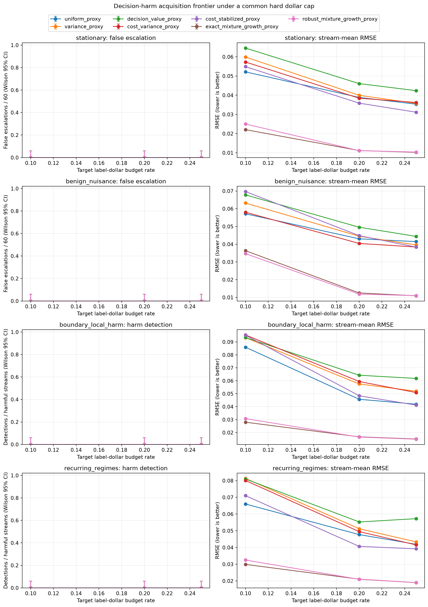

# Paired hard-budget acquisition frontier

This screening grid compares 7 query policies at target label-dollar rates 10%, 20%, 25%. It uses 60 paired seeds per scenario, seed offset 28802026, n=3200, d=16, and resolved device `NVIDIA GeForce RTX 4060 Laptop GPU`.

Within each budget level, all methods share generated streams, query uniforms, a common q_min=0.05 e-process bound, and the same pathwise dollar cap. The same stream seed is reused across budget levels to enable paired budget contrasts. The target budget changes the cap and validation-calibrated allocation; it does not change alpha or the margin. The selection grid is descriptive and does not establish a nominal false-alarm guarantee.

Detection rates use Wilson 95% intervals. Paired RMSE differences versus uniform use seed bootstrap 95% intervals. The exact McNemar p-value is shown for detection versus uniform; the p-values are unadjusted across methods and budget levels. Report harm reachability separately because budget exhaustion can censor late onsets.

|Budget|Scenario|Method|Detected / harmful|Reached / harmful|Detection rate [Wilson 95%]|False alarms / streams|RMSE|RMSE delta vs uniform [bootstrap 95%]|Mean spend|Mean labels|Processed fraction|Cap violations|McNemar p vs uniform|
|---:|---|---|---:|---:|---:|---:|---:|---:|---:|---:|---:|---:|---:|
|10%|benign_nuisance|uniform_proxy|0/0|0/0|n/a|0/60|0.0572|reference|358.95|180.8|0.754|0|nan|
|10%|benign_nuisance|variance_proxy|0/0|0/0|n/a|0/60|0.0632|+0.0061 [-0.0085, +0.0208]|358.82|181.2|0.589|0|nan|
|10%|benign_nuisance|decision_value_proxy|0/0|0/0|n/a|0/60|0.0678|+0.0107 [-0.0017, +0.0238]|358.74|181.3|0.659|0|nan|
|10%|benign_nuisance|cost_variance_proxy|0/0|0/0|n/a|0/60|0.0580|+0.0009 [-0.0081, +0.0107]|358.90|185.3|0.653|0|nan|
|10%|benign_nuisance|cost_stabilized_proxy|0/0|0/0|n/a|0/60|0.0697|+0.0126 [+0.0002, +0.0253]|352.00|186.1|0.962|0|nan|
|10%|benign_nuisance|exact_mixture_growth_proxy|0/0|0/0|n/a|0/60|0.0363|-0.0208 [-0.0340, -0.0080]|358.00|184.4|0.760|0|nan|
|10%|benign_nuisance|robust_mixture_growth_proxy|0/0|0/0|n/a|0/60|0.0347|-0.0225 [-0.0361, -0.0086]|358.04|185.0|0.740|0|nan|
|10%|boundary_local_harm|uniform_proxy|0/60|60/60|0/60 [0.000, 0.060]|0/60|0.0859|reference|348.79|232.6|0.974|0|1.000|
|10%|boundary_local_harm|variance_proxy|0/60|60/60|0/60 [0.000, 0.060]|0/60|0.0933|+0.0073 [-0.0034, +0.0184]|351.20|234.5|0.964|0|1.000|
|10%|boundary_local_harm|decision_value_proxy|0/60|60/60|0/60 [0.000, 0.060]|0/60|0.0934|+0.0074 [-0.0022, +0.0170]|347.66|232.1|0.963|0|1.000|
|10%|boundary_local_harm|cost_variance_proxy|0/60|60/60|0/60 [0.000, 0.060]|0/60|0.0954|+0.0094 [+0.0012, +0.0179]|350.44|244.4|0.966|0|1.000|
|10%|boundary_local_harm|cost_stabilized_proxy|0/60|60/60|0/60 [0.000, 0.060]|0/60|0.0952|+0.0092 [-0.0048, +0.0215]|349.73|254.2|0.973|0|1.000|
|10%|boundary_local_harm|exact_mixture_growth_proxy|0/60|60/60|0/60 [0.000, 0.060]|0/60|0.0280|-0.0579 [-0.0771, -0.0389]|358.37|247.3|0.782|0|1.000|
|10%|boundary_local_harm|robust_mixture_growth_proxy|0/60|60/60|0/60 [0.000, 0.060]|0/60|0.0308|-0.0552 [-0.0754, -0.0353]|358.36|247.8|0.753|0|1.000|
|10%|recurring_regimes|uniform_proxy|0/60|60/60|0/60 [0.000, 0.060]|0/60|0.0660|reference|348.79|232.6|0.974|0|1.000|
|10%|recurring_regimes|variance_proxy|0/60|60/60|0/60 [0.000, 0.060]|0/60|0.0813|+0.0153 [+0.0018, +0.0291]|351.20|234.5|0.964|0|1.000|
|10%|recurring_regimes|decision_value_proxy|0/60|60/60|0/60 [0.000, 0.060]|0/60|0.0810|+0.0150 [+0.0045, +0.0258]|346.45|231.0|0.964|0|1.000|
|10%|recurring_regimes|cost_variance_proxy|0/60|60/60|0/60 [0.000, 0.060]|0/60|0.0801|+0.0141 [+0.0002, +0.0277]|350.44|244.4|0.966|0|1.000|
|10%|recurring_regimes|cost_stabilized_proxy|0/60|60/60|0/60 [0.000, 0.060]|0/60|0.0710|+0.0050 [-0.0041, +0.0148]|349.73|254.2|0.973|0|1.000|
|10%|recurring_regimes|exact_mixture_growth_proxy|0/60|60/60|0/60 [0.000, 0.060]|0/60|0.0299|-0.0361 [-0.0499, -0.0228]|358.40|249.0|0.655|0|1.000|
|10%|recurring_regimes|robust_mixture_growth_proxy|0/60|60/60|0/60 [0.000, 0.060]|0/60|0.0325|-0.0335 [-0.0479, -0.0195]|358.27|249.3|0.612|0|1.000|
|10%|stationary|uniform_proxy|0/0|0/0|n/a|0/60|0.0522|reference|348.79|232.6|0.974|0|nan|
|10%|stationary|variance_proxy|0/0|0/0|n/a|0/60|0.0599|+0.0077 [+0.0001, +0.0155]|351.20|234.5|0.964|0|nan|
|10%|stationary|decision_value_proxy|0/0|0/0|n/a|0/60|0.0646|+0.0124 [+0.0032, +0.0218]|351.87|234.9|0.952|0|nan|
|10%|stationary|cost_variance_proxy|0/0|0/0|n/a|0/60|0.0573|+0.0052 [-0.0031, +0.0135]|350.44|244.4|0.966|0|nan|
|10%|stationary|cost_stabilized_proxy|0/0|0/0|n/a|0/60|0.0549|+0.0027 [-0.0025, +0.0081]|349.73|254.2|0.973|0|nan|
|10%|stationary|exact_mixture_growth_proxy|0/0|0/0|n/a|0/60|0.0221|-0.0301 [-0.0415, -0.0188]|350.04|240.5|0.928|0|nan|
|10%|stationary|robust_mixture_growth_proxy|0/0|0/0|n/a|0/60|0.0250|-0.0272 [-0.0384, -0.0159]|352.96|243.1|0.913|0|nan|
|20%|benign_nuisance|uniform_proxy|0/0|0/0|n/a|0/60|0.0430|reference|719.07|362.8|0.759|0|nan|
|20%|benign_nuisance|variance_proxy|0/0|0/0|n/a|0/60|0.0445|+0.0015 [-0.0083, +0.0114]|718.96|364.4|0.583|0|nan|
|20%|benign_nuisance|decision_value_proxy|0/0|0/0|n/a|0/60|0.0496|+0.0065 [-0.0066, +0.0195]|718.99|365.3|0.620|0|nan|
|20%|benign_nuisance|cost_variance_proxy|0/0|0/0|n/a|0/60|0.0404|-0.0026 [-0.0120, +0.0074]|718.89|372.7|0.648|0|nan|
|20%|benign_nuisance|cost_stabilized_proxy|0/0|0/0|n/a|0/60|0.0448|+0.0018 [-0.0065, +0.0102]|711.16|375.5|0.967|0|nan|
|20%|benign_nuisance|exact_mixture_growth_proxy|0/0|0/0|n/a|0/60|0.0125|-0.0305 [-0.0377, -0.0233]|718.98|373.9|0.696|0|nan|
|20%|benign_nuisance|robust_mixture_growth_proxy|0/0|0/0|n/a|0/60|0.0119|-0.0312 [-0.0383, -0.0239]|718.70|373.9|0.703|0|nan|
|20%|boundary_local_harm|uniform_proxy|0/60|60/60|0/60 [0.000, 0.060]|0/60|0.0457|reference|705.30|469.7|0.980|0|1.000|
|20%|boundary_local_harm|variance_proxy|0/60|60/60|0/60 [0.000, 0.060]|0/60|0.0575|+0.0118 [+0.0053, +0.0181]|707.90|473.5|0.966|0|1.000|
|20%|boundary_local_harm|decision_value_proxy|0/60|60/60|0/60 [0.000, 0.060]|0/60|0.0643|+0.0186 [+0.0091, +0.0275]|702.05|468.5|0.953|0|1.000|
|20%|boundary_local_harm|cost_variance_proxy|0/60|60/60|0/60 [0.000, 0.060]|0/60|0.0594|+0.0137 [+0.0048, +0.0230]|709.34|496.7|0.968|0|1.000|
|20%|boundary_local_harm|cost_stabilized_proxy|0/60|60/60|0/60 [0.000, 0.060]|0/60|0.0484|+0.0027 [-0.0033, +0.0093]|706.78|514.5|0.983|0|1.000|
|20%|boundary_local_harm|exact_mixture_growth_proxy|0/60|60/60|0/60 [0.000, 0.060]|0/60|0.0167|-0.0290 [-0.0382, -0.0200]|718.59|492.8|0.700|0|1.000|
|20%|boundary_local_harm|robust_mixture_growth_proxy|0/60|60/60|0/60 [0.000, 0.060]|0/60|0.0165|-0.0292 [-0.0384, -0.0202]|718.57|492.9|0.698|0|1.000|
|20%|recurring_regimes|uniform_proxy|0/60|60/60|0/60 [0.000, 0.060]|0/60|0.0477|reference|705.30|469.7|0.980|0|1.000|
|20%|recurring_regimes|variance_proxy|0/60|60/60|0/60 [0.000, 0.060]|0/60|0.0512|+0.0035 [-0.0057, +0.0122]|707.90|473.5|0.966|0|1.000|
|20%|recurring_regimes|decision_value_proxy|0/60|60/60|0/60 [0.000, 0.060]|0/60|0.0553|+0.0076 [-0.0030, +0.0177]|682.54|454.9|0.963|0|1.000|
|20%|recurring_regimes|cost_variance_proxy|0/60|60/60|0/60 [0.000, 0.060]|0/60|0.0495|+0.0018 [-0.0076, +0.0109]|709.34|496.7|0.968|0|1.000|
|20%|recurring_regimes|cost_stabilized_proxy|0/60|60/60|0/60 [0.000, 0.060]|0/60|0.0407|-0.0071 [-0.0133, -0.0010]|706.78|514.5|0.983|0|1.000|
|20%|recurring_regimes|exact_mixture_growth_proxy|0/60|60/60|0/60 [0.000, 0.060]|0/60|0.0211|-0.0267 [-0.0342, -0.0190]|718.50|492.2|0.517|0|1.000|
|20%|recurring_regimes|robust_mixture_growth_proxy|0/60|60/60|0/60 [0.000, 0.060]|0/60|0.0210|-0.0267 [-0.0343, -0.0192]|718.50|492.5|0.516|0|1.000|
|20%|stationary|uniform_proxy|0/0|0/0|n/a|0/60|0.0389|reference|705.30|469.7|0.980|0|nan|
|20%|stationary|variance_proxy|0/0|0/0|n/a|0/60|0.0399|+0.0011 [-0.0041, +0.0063]|707.90|473.5|0.966|0|nan|
|20%|stationary|decision_value_proxy|0/0|0/0|n/a|0/60|0.0460|+0.0072 [-0.0011, +0.0152]|710.29|474.7|0.929|0|nan|
|20%|stationary|cost_variance_proxy|0/0|0/0|n/a|0/60|0.0384|-0.0004 [-0.0064, +0.0057]|709.34|496.7|0.968|0|nan|
|20%|stationary|cost_stabilized_proxy|0/0|0/0|n/a|0/60|0.0359|-0.0030 [-0.0070, +0.0012]|706.78|514.5|0.983|0|nan|
|20%|stationary|exact_mixture_growth_proxy|0/0|0/0|n/a|0/60|0.0112|-0.0277 [-0.0337, -0.0216]|705.58|483.4|0.899|0|nan|
|20%|stationary|robust_mixture_growth_proxy|0/0|0/0|n/a|0/60|0.0111|-0.0277 [-0.0337, -0.0216]|705.65|483.8|0.898|0|nan|
|25%|benign_nuisance|uniform_proxy|0/0|0/0|n/a|0/60|0.0415|reference|899.10|453.6|0.758|0|nan|
|25%|benign_nuisance|variance_proxy|0/0|0/0|n/a|0/60|0.0396|-0.0019 [-0.0092, +0.0051]|899.08|456.0|0.582|0|nan|
|25%|benign_nuisance|decision_value_proxy|0/0|0/0|n/a|0/60|0.0444|+0.0030 [-0.0054, +0.0113]|898.92|456.8|0.618|0|nan|
|25%|benign_nuisance|cost_variance_proxy|0/0|0/0|n/a|0/60|0.0384|-0.0030 [-0.0101, +0.0041]|899.06|465.9|0.646|0|nan|
|25%|benign_nuisance|cost_stabilized_proxy|0/0|0/0|n/a|0/60|0.0384|-0.0031 [-0.0093, +0.0029]|892.77|470.7|0.970|0|nan|
|25%|benign_nuisance|exact_mixture_growth_proxy|0/0|0/0|n/a|0/60|0.0109|-0.0305 [-0.0365, -0.0243]|898.92|465.0|0.737|0|nan|
|25%|benign_nuisance|robust_mixture_growth_proxy|0/0|0/0|n/a|0/60|0.0110|-0.0305 [-0.0364, -0.0241]|898.11|464.7|0.737|0|nan|
|25%|boundary_local_harm|uniform_proxy|0/60|60/60|0/60 [0.000, 0.060]|0/60|0.0419|reference|885.28|589.0|0.982|0|1.000|
|25%|boundary_local_harm|variance_proxy|0/60|60/60|0/60 [0.000, 0.060]|0/60|0.0520|+0.0100 [+0.0034, +0.0166]|887.62|594.3|0.968|0|1.000|
|25%|boundary_local_harm|decision_value_proxy|0/60|60/60|0/60 [0.000, 0.060]|0/60|0.0618|+0.0199 [+0.0113, +0.0284]|877.03|585.4|0.943|0|1.000|
|25%|boundary_local_harm|cost_variance_proxy|0/60|60/60|0/60 [0.000, 0.060]|0/60|0.0509|+0.0090 [+0.0022, +0.0157]|889.67|622.8|0.970|0|1.000|
|25%|boundary_local_harm|cost_stabilized_proxy|0/60|60/60|0/60 [0.000, 0.060]|0/60|0.0412|-0.0007 [-0.0050, +0.0038]|885.95|644.5|0.985|0|1.000|
|25%|boundary_local_harm|exact_mixture_growth_proxy|0/60|60/60|0/60 [0.000, 0.060]|0/60|0.0150|-0.0269 [-0.0341, -0.0195]|898.65|614.9|0.713|0|1.000|
|25%|boundary_local_harm|robust_mixture_growth_proxy|0/60|60/60|0/60 [0.000, 0.060]|0/60|0.0149|-0.0271 [-0.0342, -0.0197]|898.64|614.9|0.713|0|1.000|
|25%|recurring_regimes|uniform_proxy|0/60|60/60|0/60 [0.000, 0.060]|0/60|0.0419|reference|885.28|589.0|0.982|0|1.000|
|25%|recurring_regimes|variance_proxy|0/60|60/60|0/60 [0.000, 0.060]|0/60|0.0434|+0.0014 [-0.0054, +0.0083]|887.62|594.3|0.968|0|1.000|
|25%|recurring_regimes|decision_value_proxy|0/60|60/60|0/60 [0.000, 0.060]|0/60|0.0572|+0.0153 [+0.0053, +0.0253]|854.85|569.0|0.968|0|1.000|
|25%|recurring_regimes|cost_variance_proxy|0/60|60/60|0/60 [0.000, 0.060]|0/60|0.0416|-0.0004 [-0.0060, +0.0053]|889.67|622.8|0.970|0|1.000|
|25%|recurring_regimes|cost_stabilized_proxy|0/60|60/60|0/60 [0.000, 0.060]|0/60|0.0392|-0.0027 [-0.0065, +0.0015]|885.95|644.5|0.985|0|1.000|
|25%|recurring_regimes|exact_mixture_growth_proxy|0/60|60/60|0/60 [0.000, 0.060]|0/60|0.0190|-0.0229 [-0.0300, -0.0158]|898.82|614.1|0.534|0|1.000|
|25%|recurring_regimes|robust_mixture_growth_proxy|0/60|60/60|0/60 [0.000, 0.060]|0/60|0.0190|-0.0229 [-0.0301, -0.0157]|898.86|614.2|0.534|0|1.000|
|25%|stationary|uniform_proxy|0/0|0/0|n/a|0/60|0.0354|reference|885.28|589.0|0.982|0|nan|
|25%|stationary|variance_proxy|0/0|0/0|n/a|0/60|0.0358|+0.0004 [-0.0043, +0.0050]|887.62|594.3|0.968|0|nan|
|25%|stationary|decision_value_proxy|0/0|0/0|n/a|0/60|0.0424|+0.0070 [-0.0005, +0.0146]|890.98|596.0|0.920|0|nan|
|25%|stationary|cost_variance_proxy|0/0|0/0|n/a|0/60|0.0362|+0.0009 [-0.0050, +0.0067]|889.67|622.8|0.970|0|nan|
|25%|stationary|cost_stabilized_proxy|0/0|0/0|n/a|0/60|0.0312|-0.0042 [-0.0083, -0.0001]|885.95|644.5|0.985|0|nan|
|25%|stationary|exact_mixture_growth_proxy|0/0|0/0|n/a|0/60|0.0102|-0.0251 [-0.0308, -0.0193]|867.16|594.4|0.926|0|nan|
|25%|stationary|robust_mixture_growth_proxy|0/0|0/0|n/a|0/60|0.0104|-0.0250 [-0.0307, -0.0191]|867.47|594.8|0.926|0|nan|

The grid is a screening study. Advance a query method only if its advantage persists in a separately seeded confirmation, improves decision-harm detection or cumulative decision loss at matched realized spend, and retains acceptable calibration on nondegenerate null streams. A 60-seed zero-alarm cell is a diagnostic, not proof of 5% error control.