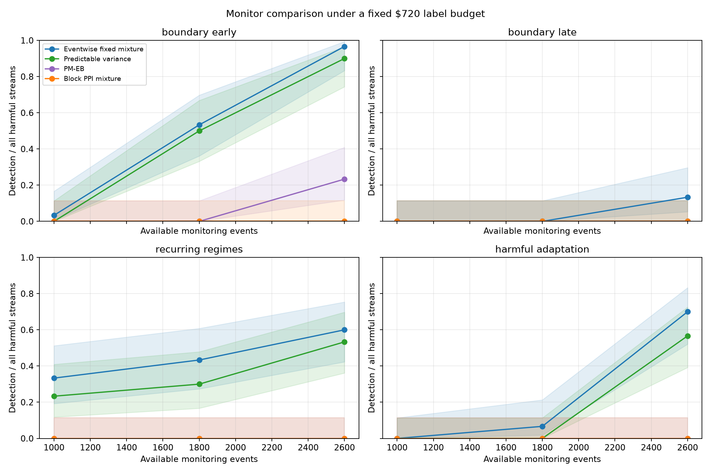

# Fixed-dollar horizon monitor development grid

This development screen compares four monitoring procedures over 30 paired seeds in each of six scenario cells and three horizons. Every run used the same $720.00 realized label-dollar cap, the same full generated n=4,000 stream, and a prefix of that stream as the available monitor horizon. The source model and pre-monitor validation split were therefore held fixed across horizons. CUDA was requested; inspect each run manifest for the resolved device.

Eventwise fixed-mixture, predictable-variance, and PM-EB monitors share the uniform-query labels within each stream. The block PPI mixture uses its registered 20-event / four-label block design under the same dollar cap; its block labels are not identical to the eventwise labels. All procedures use alpha=.05, harm margin=.10, q_min=.20 (eventwise), and the predeclared fixed 10% block-PPI mixture. This is a development grid: intervals are descriptive, no winner is selected, and no claim of general superiority follows.

## Harm results

Rates use all evaluator-classified harmful streams in the denominator; the reached-harm rate is reported separately so budget-censored onsets are visible. Wilson intervals are marginal and not multiplicity-adjusted.

| Cell | Horizon | Monitor | Detect / harm | Reached | Rate (95% Wilson) | Reached rate | Mean delay | Mean events | Mean labels | Mean spend |
|---|---:|---|---:|---:|---:|---:|---:|---:|---:|---:|
| boundary_early | 1000 | fixed_mixture | 1/30 | 30/30 | 0.033 [0.006, 0.167] | 0.033 | 548.0 | 1000.0 | 199.3 | $298.23 |
| boundary_early | 1000 | pm_eb | 0/30 | 30/30 | 0.000 [0.000, 0.114] | 0.000 | nan | 1000.0 | 199.3 | $298.23 |
| boundary_early | 1000 | pprm_mix_w0p1 | 0/30 | 30/30 | 0.000 [0.000, 0.114] | 0.000 | nan | 1000.0 | 200.0 | $300.40 |
| boundary_early | 1000 | predictable_variance | 0/30 | 30/30 | 0.000 [0.000, 0.114] | 0.000 | nan | 1000.0 | 199.3 | $298.23 |
| boundary_early | 1800 | fixed_mixture | 16/30 | 30/30 | 0.533 [0.361, 0.698] | 0.533 | 1087.4 | 1800.0 | 358.9 | $536.73 |
| boundary_early | 1800 | pm_eb | 0/30 | 30/30 | 0.000 [0.000, 0.114] | 0.000 | nan | 1800.0 | 358.9 | $536.73 |
| boundary_early | 1800 | pprm_mix_w0p1 | 0/30 | 30/30 | 0.000 [0.000, 0.114] | 0.000 | nan | 1800.0 | 360.0 | $540.33 |
| boundary_early | 1800 | predictable_variance | 15/30 | 30/30 | 0.500 [0.332, 0.668] | 0.500 | 1176.4 | 1800.0 | 358.9 | $536.73 |
| boundary_early | 2600 | fixed_mixture | 29/30 | 30/30 | 0.967 [0.833, 0.994] | 0.967 | 1380.1 | 2409.4 | 478.7 | $717.78 |
| boundary_early | 2600 | pm_eb | 7/30 | 30/30 | 0.233 [0.118, 0.409] | 0.233 | 1837.0 | 2409.4 | 478.7 | $717.78 |
| boundary_early | 2600 | pprm_mix_w0p1 | 0/30 | 30/30 | 0.000 [0.000, 0.114] | 0.000 | nan | 2372.7 | 474.5 | $712.73 |
| boundary_early | 2600 | predictable_variance | 27/30 | 30/30 | 0.900 [0.744, 0.965] | 0.900 | 1446.3 | 2409.4 | 478.7 | $717.78 |
| boundary_late | 1000 | fixed_mixture | 0/30 | 0/30 | 0.000 [0.000, 0.114] | nan | nan | 1000.0 | 199.3 | $298.23 |
| boundary_late | 1000 | pm_eb | 0/30 | 0/30 | 0.000 [0.000, 0.114] | nan | nan | 1000.0 | 199.3 | $298.23 |
| boundary_late | 1000 | pprm_mix_w0p1 | 0/30 | 0/30 | 0.000 [0.000, 0.114] | nan | nan | 1000.0 | 200.0 | $300.40 |
| boundary_late | 1000 | predictable_variance | 0/30 | 0/30 | 0.000 [0.000, 0.114] | nan | nan | 1000.0 | 199.3 | $298.23 |
| boundary_late | 1800 | fixed_mixture | 0/30 | 30/30 | 0.000 [0.000, 0.114] | 0.000 | nan | 1800.0 | 358.9 | $536.73 |
| boundary_late | 1800 | pm_eb | 0/30 | 30/30 | 0.000 [0.000, 0.114] | 0.000 | nan | 1800.0 | 358.9 | $536.73 |
| boundary_late | 1800 | pprm_mix_w0p1 | 0/30 | 30/30 | 0.000 [0.000, 0.114] | 0.000 | nan | 1800.0 | 360.0 | $540.33 |
| boundary_late | 1800 | predictable_variance | 0/30 | 30/30 | 0.000 [0.000, 0.114] | 0.000 | nan | 1800.0 | 358.9 | $536.73 |
| boundary_late | 2600 | fixed_mixture | 4/30 | 30/30 | 0.133 [0.053, 0.297] | 0.133 | 587.8 | 2409.4 | 478.7 | $717.78 |
| boundary_late | 2600 | pm_eb | 0/30 | 30/30 | 0.000 [0.000, 0.114] | 0.000 | nan | 2409.4 | 478.7 | $717.78 |
| boundary_late | 2600 | pprm_mix_w0p1 | 0/30 | 30/30 | 0.000 [0.000, 0.114] | 0.000 | nan | 2372.7 | 474.5 | $712.73 |
| boundary_late | 2600 | predictable_variance | 0/30 | 30/30 | 0.000 [0.000, 0.114] | 0.000 | nan | 2409.4 | 478.7 | $717.78 |
| harmful_adaptation | 1000 | fixed_mixture | 0/30 | 1/30 | 0.000 [0.000, 0.114] | 0.000 | nan | 1000.0 | 199.3 | $298.23 |
| harmful_adaptation | 1000 | pm_eb | 0/30 | 1/30 | 0.000 [0.000, 0.114] | 0.000 | nan | 1000.0 | 199.3 | $298.23 |
| harmful_adaptation | 1000 | pprm_mix_w0p1 | 0/30 | 1/30 | 0.000 [0.000, 0.114] | 0.000 | nan | 1000.0 | 200.0 | $300.40 |
| harmful_adaptation | 1000 | predictable_variance | 0/30 | 1/30 | 0.000 [0.000, 0.114] | 0.000 | nan | 1000.0 | 199.3 | $298.23 |
| harmful_adaptation | 1800 | fixed_mixture | 2/30 | 30/30 | 0.067 [0.018, 0.213] | 0.067 | 754.5 | 1800.0 | 358.9 | $536.73 |
| harmful_adaptation | 1800 | pm_eb | 0/30 | 30/30 | 0.000 [0.000, 0.114] | 0.000 | nan | 1800.0 | 358.9 | $536.73 |
| harmful_adaptation | 1800 | pprm_mix_w0p1 | 0/30 | 30/30 | 0.000 [0.000, 0.114] | 0.000 | nan | 1800.0 | 360.0 | $540.33 |
| harmful_adaptation | 1800 | predictable_variance | 0/30 | 30/30 | 0.000 [0.000, 0.114] | 0.000 | nan | 1800.0 | 358.9 | $536.73 |
| harmful_adaptation | 2600 | fixed_mixture | 21/30 | 30/30 | 0.700 [0.521, 0.833] | 0.700 | 1144.8 | 2409.4 | 478.7 | $717.78 |
| harmful_adaptation | 2600 | pm_eb | 0/30 | 30/30 | 0.000 [0.000, 0.114] | 0.000 | nan | 2409.4 | 478.7 | $717.78 |
| harmful_adaptation | 2600 | pprm_mix_w0p1 | 0/30 | 30/30 | 0.000 [0.000, 0.114] | 0.000 | nan | 2372.7 | 474.5 | $712.73 |
| harmful_adaptation | 2600 | predictable_variance | 17/30 | 30/30 | 0.567 [0.392, 0.726] | 0.567 | 1170.3 | 2409.4 | 478.7 | $717.78 |
| recurring_regimes | 1000 | fixed_mixture | 10/30 | 30/30 | 0.333 [0.192, 0.512] | 0.333 | 785.0 | 1000.0 | 199.3 | $298.23 |
| recurring_regimes | 1000 | pm_eb | 0/30 | 30/30 | 0.000 [0.000, 0.114] | 0.000 | nan | 1000.0 | 199.3 | $298.23 |
| recurring_regimes | 1000 | pprm_mix_w0p1 | 0/30 | 30/30 | 0.000 [0.000, 0.114] | 0.000 | nan | 1000.0 | 200.0 | $300.40 |
| recurring_regimes | 1000 | predictable_variance | 7/30 | 30/30 | 0.233 [0.118, 0.409] | 0.233 | 789.7 | 1000.0 | 199.3 | $298.23 |
| recurring_regimes | 1800 | fixed_mixture | 13/30 | 30/30 | 0.433 [0.274, 0.608] | 0.433 | 899.6 | 1800.0 | 358.9 | $536.73 |
| recurring_regimes | 1800 | pm_eb | 0/30 | 30/30 | 0.000 [0.000, 0.114] | 0.000 | nan | 1800.0 | 358.9 | $536.73 |
| recurring_regimes | 1800 | pprm_mix_w0p1 | 0/30 | 30/30 | 0.000 [0.000, 0.114] | 0.000 | nan | 1800.0 | 360.0 | $540.33 |
| recurring_regimes | 1800 | predictable_variance | 9/30 | 30/30 | 0.300 [0.167, 0.479] | 0.300 | 958.7 | 1800.0 | 358.9 | $536.73 |
| recurring_regimes | 2600 | fixed_mixture | 18/30 | 30/30 | 0.600 [0.423, 0.754] | 0.600 | 1273.2 | 2409.4 | 478.7 | $717.78 |
| recurring_regimes | 2600 | pm_eb | 0/30 | 30/30 | 0.000 [0.000, 0.114] | 0.000 | nan | 2409.4 | 478.7 | $717.78 |
| recurring_regimes | 2600 | pprm_mix_w0p1 | 0/30 | 30/30 | 0.000 [0.000, 0.114] | 0.000 | nan | 2372.7 | 474.5 | $712.73 |
| recurring_regimes | 2600 | predictable_variance | 16/30 | 30/30 | 0.533 [0.361, 0.698] | 0.533 | 1483.7 | 2409.4 | 478.7 | $717.78 |

## Population-null controls

| Cell | Horizon | Monitor | False escalations / streams | Rate (95% Wilson) | Mean events | Mean labels | Mean spend |
|---|---:|---|---:|---:|---:|---:|---:|
| benign_nuisance | 1000 | fixed_mixture | 0/30 | 0.000 [0.000, 0.114] | 1000.0 | 199.3 | $298.23 |
| benign_nuisance | 1000 | pm_eb | 0/30 | 0.000 [0.000, 0.114] | 1000.0 | 199.3 | $298.23 |
| benign_nuisance | 1000 | pprm_mix_w0p1 | 0/30 | 0.000 [0.000, 0.114] | 1000.0 | 200.0 | $300.40 |
| benign_nuisance | 1000 | predictable_variance | 0/30 | 0.000 [0.000, 0.114] | 1000.0 | 199.3 | $298.23 |
| benign_nuisance | 1800 | fixed_mixture | 0/30 | 0.000 [0.000, 0.114] | 1797.8 | 358.3 | $673.45 |
| benign_nuisance | 1800 | pm_eb | 0/30 | 0.000 [0.000, 0.114] | 1797.8 | 358.3 | $673.45 |
| benign_nuisance | 1800 | pprm_mix_w0p1 | 0/30 | 0.000 [0.000, 0.114] | 1800.0 | 360.0 | $678.30 |
| benign_nuisance | 1800 | predictable_variance | 0/30 | 0.000 [0.000, 0.114] | 1797.8 | 358.3 | $673.45 |
| benign_nuisance | 2600 | fixed_mixture | 0/30 | 0.000 [0.000, 0.114] | 1891.1 | 377.5 | $718.66 |
| benign_nuisance | 2600 | pm_eb | 0/30 | 0.000 [0.000, 0.114] | 1891.1 | 377.5 | $718.66 |
| benign_nuisance | 2600 | pprm_mix_w0p1 | 0/30 | 0.000 [0.000, 0.114] | 1877.3 | 375.5 | $714.87 |
| benign_nuisance | 2600 | predictable_variance | 0/30 | 0.000 [0.000, 0.114] | 1891.1 | 377.5 | $718.66 |
| stationary | 1000 | fixed_mixture | 0/30 | 0.000 [0.000, 0.114] | 1000.0 | 199.3 | $298.23 |
| stationary | 1000 | pm_eb | 0/30 | 0.000 [0.000, 0.114] | 1000.0 | 199.3 | $298.23 |
| stationary | 1000 | pprm_mix_w0p1 | 0/30 | 0.000 [0.000, 0.114] | 1000.0 | 200.0 | $300.40 |
| stationary | 1000 | predictable_variance | 0/30 | 0.000 [0.000, 0.114] | 1000.0 | 199.3 | $298.23 |
| stationary | 1800 | fixed_mixture | 0/30 | 0.000 [0.000, 0.114] | 1800.0 | 358.9 | $536.73 |
| stationary | 1800 | pm_eb | 0/30 | 0.000 [0.000, 0.114] | 1800.0 | 358.9 | $536.73 |
| stationary | 1800 | pprm_mix_w0p1 | 0/30 | 0.000 [0.000, 0.114] | 1800.0 | 360.0 | $540.33 |
| stationary | 1800 | predictable_variance | 0/30 | 0.000 [0.000, 0.114] | 1800.0 | 358.9 | $536.73 |
| stationary | 2600 | fixed_mixture | 0/30 | 0.000 [0.000, 0.114] | 2409.4 | 478.7 | $717.78 |
| stationary | 2600 | pm_eb | 0/30 | 0.000 [0.000, 0.114] | 2409.4 | 478.7 | $717.78 |
| stationary | 2600 | pprm_mix_w0p1 | 0/30 | 0.000 [0.000, 0.114] | 2372.7 | 474.5 | $712.73 |
| stationary | 2600 | predictable_variance | 0/30 | 0.000 [0.000, 0.114] | 2409.4 | 478.7 | $717.78 |

## Paired detection contrasts

Positive rate difference favors the fixed mixture. Paired bootstrap intervals and exact McNemar p-values use common seeds; Holm adjustment covers all fixed-mixture-versus-comparator contrasts across the 12 harmful cell/horizon combinations. These remain exploratory because this block is a development grid.

| Cell | Horizon | Comparator | Fixed-only / comparator-only | Difference (paired 95% bootstrap CI) | Exact p | Holm p |
|---|---:|---|---:|---:|---:|---:|
| boundary_early | 1000 | predictable_variance | 1/0 | 0.033 [0.000, 0.100] | 1 | 1 |
| boundary_early | 1000 | pm_eb | 1/0 | 0.033 [0.000, 0.100] | 1 | 1 |
| boundary_early | 1000 | pprm_mix_w0p1 | 1/0 | 0.033 [0.000, 0.100] | 1 | 1 |
| boundary_early | 1800 | predictable_variance | 1/0 | 0.033 [0.000, 0.100] | 1 | 1 |
| boundary_early | 1800 | pm_eb | 16/0 | 0.533 [0.367, 0.700] | 3.052e-05 | 0.0009155 |
| boundary_early | 1800 | pprm_mix_w0p1 | 16/0 | 0.533 [0.367, 0.700] | 3.052e-05 | 0.0009155 |
| boundary_early | 2600 | predictable_variance | 2/0 | 0.067 [0.000, 0.167] | 0.5 | 1 |
| boundary_early | 2600 | pm_eb | 22/0 | 0.733 [0.567, 0.867] | 4.768e-07 | 1.669e-05 |
| boundary_early | 2600 | pprm_mix_w0p1 | 29/0 | 0.967 [0.900, 1.000] | 3.725e-09 | 1.341e-07 |
| boundary_late | 1000 | predictable_variance | 0/0 | 0.000 [0.000, 0.000] | 1 | 1 |
| boundary_late | 1000 | pm_eb | 0/0 | 0.000 [0.000, 0.000] | 1 | 1 |
| boundary_late | 1000 | pprm_mix_w0p1 | 0/0 | 0.000 [0.000, 0.000] | 1 | 1 |
| boundary_late | 1800 | predictable_variance | 0/0 | 0.000 [0.000, 0.000] | 1 | 1 |
| boundary_late | 1800 | pm_eb | 0/0 | 0.000 [0.000, 0.000] | 1 | 1 |
| boundary_late | 1800 | pprm_mix_w0p1 | 0/0 | 0.000 [0.000, 0.000] | 1 | 1 |
| boundary_late | 2600 | predictable_variance | 4/0 | 0.133 [0.033, 0.267] | 0.125 | 1 |
| boundary_late | 2600 | pm_eb | 4/0 | 0.133 [0.033, 0.267] | 0.125 | 1 |
| boundary_late | 2600 | pprm_mix_w0p1 | 4/0 | 0.133 [0.033, 0.267] | 0.125 | 1 |
| harmful_adaptation | 1000 | predictable_variance | 0/0 | 0.000 [0.000, 0.000] | 1 | 1 |
| harmful_adaptation | 1000 | pm_eb | 0/0 | 0.000 [0.000, 0.000] | 1 | 1 |
| harmful_adaptation | 1000 | pprm_mix_w0p1 | 0/0 | 0.000 [0.000, 0.000] | 1 | 1 |
| harmful_adaptation | 1800 | predictable_variance | 2/0 | 0.067 [0.000, 0.167] | 0.5 | 1 |
| harmful_adaptation | 1800 | pm_eb | 2/0 | 0.067 [0.000, 0.167] | 0.5 | 1 |
| harmful_adaptation | 1800 | pprm_mix_w0p1 | 2/0 | 0.067 [0.000, 0.167] | 0.5 | 1 |
| harmful_adaptation | 2600 | predictable_variance | 4/0 | 0.133 [0.033, 0.267] | 0.125 | 1 |
| harmful_adaptation | 2600 | pm_eb | 21/0 | 0.700 [0.533, 0.867] | 9.537e-07 | 3.242e-05 |
| harmful_adaptation | 2600 | pprm_mix_w0p1 | 21/0 | 0.700 [0.533, 0.867] | 9.537e-07 | 3.242e-05 |
| recurring_regimes | 1000 | predictable_variance | 3/0 | 0.100 [0.000, 0.233] | 0.25 | 1 |
| recurring_regimes | 1000 | pm_eb | 10/0 | 0.333 [0.167, 0.500] | 0.001953 | 0.05078 |
| recurring_regimes | 1000 | pprm_mix_w0p1 | 10/0 | 0.333 [0.167, 0.500] | 0.001953 | 0.05078 |
| recurring_regimes | 1800 | predictable_variance | 4/0 | 0.133 [0.033, 0.267] | 0.125 | 1 |
| recurring_regimes | 1800 | pm_eb | 13/0 | 0.433 [0.267, 0.600] | 0.0002441 | 0.006836 |
| recurring_regimes | 1800 | pprm_mix_w0p1 | 13/0 | 0.433 [0.267, 0.600] | 0.0002441 | 0.006836 |
| recurring_regimes | 2600 | predictable_variance | 2/0 | 0.067 [0.000, 0.167] | 0.5 | 1 |
| recurring_regimes | 2600 | pm_eb | 18/0 | 0.600 [0.433, 0.767] | 7.629e-06 | 0.0002441 |
| recurring_regimes | 2600 | pprm_mix_w0p1 | 18/0 | 0.600 [0.433, 0.767] | 7.629e-06 | 0.0002441 |

## Interpretation limits

The synthetic evaluator supplies true material-harm onset and labels only to scoring; the monitoring procedures receive the declared query feedback. This study holds the generated stream, source fit, validation slice, and total dollar cap fixed across available horizons. It does not establish validity for delayed feedback, arbitrary serial dependence, adaptively selected policy candidates, or deployment distributions beyond these registered generators. The comparison identifies empirical power and cost trade-offs for a development design; a confirmatory claim requires a frozen method and separate seed block.

