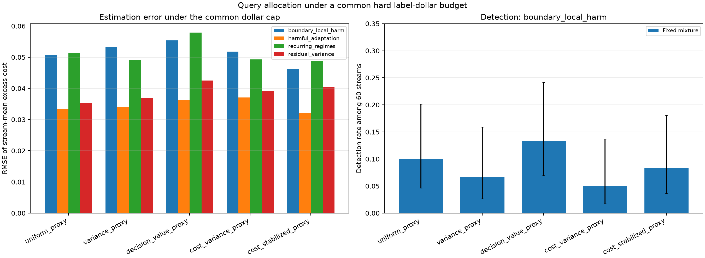

# Common hard label-dollar budget comparison

Evaluated 60 seeds per scenario on `cuda`. Every policy received the same per-stream dollar cap, calibrated from the mean tariff in the pre-monitor validation slice. Methods share per-seed uniform random variates to enable paired comparisons. The maximum tariff support is fixed at 2.5; the monitor stops before the next event once the remaining balance is below that support maximum. This makes every processed event's query propensity positive and predictable, while ensuring spend never exceeds the cap.
All methods use the common configured propensity floor for their e-process bound.

The e-process is evaluated only through its budget stopping time. Harm detection is reported over evaluator-labeled alternatives and over onsets reached before budget stopping. Stationary and benign-nuisance controls are population nulls; finite-stream oracle flags are listed separately and every alarm on these controls counts as a false escalation. Stream seeds are the inferential units. The outcomes and tariffs are synthetic; current and reference policy costs are paired on the same label.

|Scenario|Method|Mean cap|Mean spend|Mean cap use|Mean labels|Monitor fraction|Stream-mean RMSE|Harm reached / harmful streams|Pathwise oracle flags|Fixed detection all / reached|Multiscale detection all / reached|Protected detection all / reached|Fixed / multiscale / protected false escalation|
|---:|---:|---:|---:|---:|---:|---:|---:|---:|---:|---:|---:|---:|---:|
|boundary_local_harm|cost_stabilized_proxy|720.79|706.33|0.980|513.1|0.983|0.0462|60/60|60|0.083 / 0.083|n/a / n/a|n/a / n/a|0.000 / n/a / n/a|
|boundary_local_harm|cost_variance_proxy|720.79|707.34|0.981|491.0|0.972|0.0518|60/60|60|0.050 / 0.050|n/a / n/a|n/a / n/a|0.000 / n/a / n/a|
|boundary_local_harm|decision_value_proxy|720.79|703.32|0.976|467.2|0.962|0.0554|60/60|60|0.133 / 0.133|n/a / n/a|n/a / n/a|0.000 / n/a / n/a|
|boundary_local_harm|uniform_proxy|720.79|703.61|0.976|468.1|0.982|0.0506|60/60|60|0.100 / 0.100|n/a / n/a|n/a / n/a|0.000 / n/a / n/a|
|boundary_local_harm|variance_proxy|720.79|707.43|0.982|470.3|0.970|0.0532|60/60|60|0.067 / 0.067|n/a / n/a|n/a / n/a|0.000 / n/a / n/a|
|harmful_adaptation|cost_stabilized_proxy|720.79|706.33|0.980|513.1|0.983|0.0321|60/60|60|0.017 / 0.017|n/a / n/a|n/a / n/a|0.000 / n/a / n/a|
|harmful_adaptation|cost_variance_proxy|720.79|707.34|0.981|491.0|0.972|0.0371|60/60|60|0.017 / 0.017|n/a / n/a|n/a / n/a|0.000 / n/a / n/a|
|harmful_adaptation|decision_value_proxy|720.79|703.43|0.976|467.6|0.959|0.0364|60/60|60|0.017 / 0.017|n/a / n/a|n/a / n/a|0.000 / n/a / n/a|
|harmful_adaptation|uniform_proxy|720.79|703.61|0.976|468.1|0.982|0.0334|60/60|60|0.000 / 0.000|n/a / n/a|n/a / n/a|0.000 / n/a / n/a|
|harmful_adaptation|variance_proxy|720.79|707.43|0.982|470.3|0.970|0.0340|60/60|60|0.000 / 0.000|n/a / n/a|n/a / n/a|0.000 / n/a / n/a|
|recurring_regimes|cost_stabilized_proxy|720.79|706.33|0.980|513.1|0.983|0.0488|60/60|60|0.000 / 0.000|n/a / n/a|n/a / n/a|0.000 / n/a / n/a|
|recurring_regimes|cost_variance_proxy|720.79|707.34|0.981|491.0|0.972|0.0493|60/60|60|0.017 / 0.017|n/a / n/a|n/a / n/a|0.000 / n/a / n/a|
|recurring_regimes|decision_value_proxy|720.79|694.95|0.964|461.5|0.981|0.0579|60/60|60|0.067 / 0.067|n/a / n/a|n/a / n/a|0.000 / n/a / n/a|
|recurring_regimes|uniform_proxy|720.79|703.61|0.976|468.1|0.982|0.0513|60/60|60|0.067 / 0.067|n/a / n/a|n/a / n/a|0.000 / n/a / n/a|
|recurring_regimes|variance_proxy|720.79|707.43|0.982|470.3|0.970|0.0492|60/60|60|0.033 / 0.033|n/a / n/a|n/a / n/a|0.000 / n/a / n/a|
|residual_variance|cost_stabilized_proxy|720.79|706.33|0.980|513.1|0.983|0.0404|60/60|60|0.000 / 0.000|n/a / n/a|n/a / n/a|0.000 / n/a / n/a|
|residual_variance|cost_variance_proxy|720.79|707.34|0.981|491.0|0.972|0.0391|60/60|60|0.000 / 0.000|n/a / n/a|n/a / n/a|0.000 / n/a / n/a|
|residual_variance|decision_value_proxy|720.79|709.05|0.984|471.9|0.946|0.0425|60/60|60|0.000 / 0.000|n/a / n/a|n/a / n/a|0.000 / n/a / n/a|
|residual_variance|uniform_proxy|720.79|703.61|0.976|468.1|0.982|0.0354|60/60|60|0.000 / 0.000|n/a / n/a|n/a / n/a|0.000 / n/a / n/a|
|residual_variance|variance_proxy|720.79|707.43|0.982|470.3|0.970|0.0369|60/60|60|0.000 / 0.000|n/a / n/a|n/a / n/a|0.000 / n/a / n/a|

## Full-horizon consistency check

This run evaluates each e-process only through its hard-budget stopping time and does not recompute a full-horizon monitor. Any comparison with a full-monitor baseline must use matching stream seeds and query random numbers; the earlier 30-seed pilot consistency check is recorded in the Paper 3 research log.

## Interpretation limits

This is an allocation comparison under a finite spend cap, not an intervention controller and not a new sequential-test theorem. The hard-cap stopping time is based on past realized spend, not current evaluator truth. The e-process validity still requires the documented bounded-increment conditional-mean null and predictable query probabilities. Early budget exhaustion censors later harm onsets; report both reachability and detection. Realized label dollars are bounded, while the number of labels and monitor horizon remain random. The saved sum of per-event `q_t * cost_t` is a predictable-spend compensator along the realized stopping path; its pathwise sum can exceed the hard cap and it must not be read as realized spend.

Reproduce with `uv run shiftlab-dive-hard-budget --seeds 60 --seed-offset 20363022 --n 3200 --d 16 --budget-rate 0.2 --q-min 0.1 --q-max 0.8 --device cuda --scenarios boundary_local_harm residual_variance recurring_regimes harmful_adaptation --methods uniform_proxy variance_proxy decision_value_proxy cost_variance_proxy cost_stabilized_proxy --common-eprocess-bound --output outputs/hard_budget_extended_scenarios_60`.

## Paired comparison against uniform sampling

RMSE intervals are paired percentile bootstraps over independent seeds (20,000 resamples). Spend, label-count and monitor-fraction intervals are paired t intervals. They are descriptive and do not adjust for selecting a method after seeing this grid.

|Scenario|Method|RMSE difference (95% bootstrap CI)|Spend difference (95% t CI)|Label difference (95% t CI)|Monitor-fraction difference (95% t CI)|Harm detected / reached / harmful|False escalations / streams|
|---|---|---:|---:|---:|---:|---:|---:|
|boundary_local_harm|cost_stabilized_proxy|-0.0044 [-0.0100, 0.0011]|2.72 [-0.41, 5.85]|45.0 [42.5, 47.5]|0.000 [-0.004, 0.005]|5 / 60 / 60|0 / 60|
|boundary_local_harm|cost_variance_proxy|0.0012 [-0.0057, 0.0087]|3.73 [-0.19, 7.65]|22.9 [19.3, 26.5]|-0.011 [-0.017, -0.005]|3 / 60 / 60|0 / 60|
|boundary_local_harm|decision_value_proxy|0.0047 [-0.0043, 0.0133]|-0.28 [-6.39, 5.83]|-0.8 [-5.0, 3.4]|-0.020 [-0.031, -0.009]|8 / 60 / 60|0 / 60|
|boundary_local_harm|variance_proxy|0.0025 [-0.0056, 0.0110]|3.83 [-0.47, 8.13]|2.2 [-1.2, 5.6]|-0.012 [-0.019, -0.006]|4 / 60 / 60|0 / 60|
|harmful_adaptation|cost_stabilized_proxy|-0.0014 [-0.0057, 0.0029]|2.72 [-0.41, 5.85]|45.0 [42.5, 47.5]|0.000 [-0.004, 0.005]|1 / 60 / 60|0 / 60|
|harmful_adaptation|cost_variance_proxy|0.0037 [-0.0019, 0.0094]|3.73 [-0.19, 7.65]|22.9 [19.3, 26.5]|-0.011 [-0.017, -0.005]|1 / 60 / 60|0 / 60|
|harmful_adaptation|decision_value_proxy|0.0030 [-0.0028, 0.0084]|-0.18 [-5.76, 5.41]|-0.4 [-4.4, 3.5]|-0.024 [-0.035, -0.013]|1 / 60 / 60|0 / 60|
|harmful_adaptation|variance_proxy|0.0006 [-0.0046, 0.0059]|3.83 [-0.47, 8.13]|2.2 [-1.2, 5.6]|-0.012 [-0.019, -0.006]|0 / 60 / 60|0 / 60|
|recurring_regimes|cost_stabilized_proxy|-0.0026 [-0.0096, 0.0045]|2.72 [-0.41, 5.85]|45.0 [42.5, 47.5]|0.000 [-0.004, 0.005]|0 / 60 / 60|0 / 60|
|recurring_regimes|cost_variance_proxy|-0.0021 [-0.0079, 0.0037]|3.73 [-0.19, 7.65]|22.9 [19.3, 26.5]|-0.011 [-0.017, -0.005]|1 / 60 / 60|0 / 60|
|recurring_regimes|decision_value_proxy|0.0065 [-0.0029, 0.0150]|-8.65 [-15.88, -1.43]|-6.6 [-11.6, -1.5]|-0.002 [-0.010, 0.006]|4 / 60 / 60|0 / 60|
|recurring_regimes|variance_proxy|-0.0021 [-0.0101, 0.0057]|3.83 [-0.47, 8.13]|2.2 [-1.2, 5.6]|-0.012 [-0.019, -0.006]|2 / 60 / 60|0 / 60|
|residual_variance|cost_stabilized_proxy|0.0050 [-0.0003, 0.0107]|2.72 [-0.41, 5.85]|45.0 [42.5, 47.5]|0.000 [-0.004, 0.005]|0 / 60 / 60|0 / 60|
|residual_variance|cost_variance_proxy|0.0037 [-0.0014, 0.0089]|3.73 [-0.19, 7.65]|22.9 [19.3, 26.5]|-0.011 [-0.017, -0.005]|0 / 60 / 60|0 / 60|
|residual_variance|decision_value_proxy|0.0071 [0.0003, 0.0140]|5.45 [-0.14, 11.04]|3.8 [-0.3, 7.9]|-0.036 [-0.048, -0.024]|0 / 60 / 60|0 / 60|
|residual_variance|variance_proxy|0.0015 [-0.0032, 0.0063]|3.83 [-0.47, 8.13]|2.2 [-1.2, 5.6]|-0.012 [-0.019, -0.006]|0 / 60 / 60|0 / 60|
