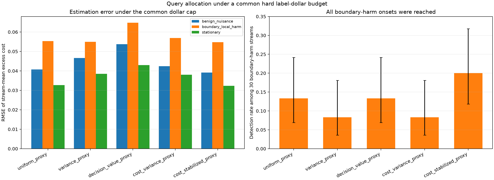

# Common hard label-dollar budget comparison

Evaluated 60 seeds per scenario on `cuda`. Every policy received the same per-stream dollar cap, calibrated from the mean tariff in the pre-monitor validation slice. Methods share per-seed uniform random variates to enable paired comparisons. The maximum tariff support is fixed at 2.5; the monitor stops before the next event once the remaining balance is below that support maximum. This makes every processed event's query propensity positive and predictable, while ensuring spend never exceeds the cap.
All methods use the common configured propensity floor for their e-process bound.

The e-process is evaluated only through its budget stopping time. Harm detection is reported both over all evaluator-labeled harmful streams and over harmful streams whose onset occurred before budget stopping; the latter avoids calling an unobserved late onset a monitor miss. Stream seeds are the inferential units. The outcomes and tariffs are synthetic; current and reference policy costs are paired on the same label.

|Scenario|Method|Mean cap|Mean spend|Mean cap use|Mean labels|Monitor fraction|Stream-mean RMSE|Harm reached / harmful streams|Detection all / reached|False escalation|
|---|---|---:|---:|---:|---:|---:|---:|---:|---:|---:|
|benign_nuisance|cost_stabilized_proxy|721.37|716.12|0.993|377.6|0.959|0.0391|6/6|0.000 / 0.000|0.000|
|benign_nuisance|cost_variance_proxy|721.37|720.05|0.998|372.4|0.648|0.0424|6/6|0.000 / 0.000|0.000|
|benign_nuisance|decision_value_proxy|721.37|720.09|0.998|365.2|0.622|0.0537|6/6|0.000 / 0.000|0.000|
|benign_nuisance|uniform_proxy|721.37|719.94|0.998|363.0|0.755|0.0407|6/6|0.000 / 0.000|0.000|
|benign_nuisance|variance_proxy|721.37|720.01|0.998|364.4|0.587|0.0466|6/6|0.000 / 0.000|0.000|
|boundary_local_harm|cost_stabilized_proxy|721.37|713.25|0.989|518.3|0.979|0.0548|60/60|0.200 / 0.200|0.000|
|boundary_local_harm|cost_variance_proxy|721.37|715.71|0.992|498.8|0.972|0.0569|60/60|0.083 / 0.083|0.000|
|boundary_local_harm|decision_value_proxy|721.37|709.75|0.984|473.6|0.957|0.0647|60/60|0.133 / 0.133|0.000|
|boundary_local_harm|uniform_proxy|721.37|712.42|0.988|473.8|0.981|0.0554|60/60|0.133 / 0.133|0.000|
|boundary_local_harm|variance_proxy|721.37|715.18|0.991|476.7|0.970|0.0549|60/60|0.083 / 0.083|0.000|
|stationary|cost_stabilized_proxy|721.37|713.25|0.989|518.3|0.979|0.0323|1/1|0.000 / 0.000|0.000|
|stationary|cost_variance_proxy|721.37|715.71|0.992|498.8|0.972|0.0380|1/1|0.000 / 0.000|0.000|
|stationary|decision_value_proxy|721.37|714.57|0.991|476.4|0.938|0.0429|1/1|0.000 / 0.000|0.000|
|stationary|uniform_proxy|721.37|712.42|0.988|473.8|0.981|0.0327|1/1|0.000 / 0.000|0.000|
|stationary|variance_proxy|721.37|715.18|0.991|476.7|0.970|0.0384|1/1|0.000 / 0.000|0.000|

## Full-horizon consistency check

Using the same per-seed query random numbers, the full-monitor uniform baseline produced five boundary-harm alarms. Four occurred before hard-budget stopping and are reproduced at identical event indices; the fifth occurred at event 2,279 on a stream stopped at event 2,232, so it is correctly censored by the budget horizon.

## Interpretation limits

This is an allocation comparison under a finite spend cap, not an intervention controller and not a new sequential-test theorem. The hard-cap stopping time is based on past realized spend, not current evaluator truth. The e-process validity still requires the documented bounded-increment conditional-mean null and predictable query probabilities. Early budget exhaustion censors later harm onsets; report both reachability and detection. Realized label dollars are bounded, while the number of labels and monitor horizon remain random. The saved sum of per-event `q_t * cost_t` is a predictable-spend compensator along the realized stopping path; its pathwise sum can exceed the hard cap and it must not be read as realized spend.

Reproduce with `uv run shiftlab-dive-hard-budget --seeds 60 --n 3200 --device cuda --common-eprocess-bound --output outputs/hard_budget_matched_qmin_010_replication_60`.

## Paired comparison against uniform sampling

RMSE intervals are paired percentile bootstraps over independent seeds (20,000 resamples). Spend, label-count and monitor-fraction intervals are paired t intervals. They are descriptive and do not adjust for selecting a method after seeing this grid.

|Scenario|Method|RMSE difference (95% bootstrap CI)|Spend difference (95% t CI)|Label difference (95% t CI)|Monitor-fraction difference (95% t CI)|Harm detected / reached / harmful|False escalations / streams|
|---|---|---:|---:|---:|---:|---:|---:|
|benign_nuisance|cost_stabilized_proxy|-0.0016 [-0.0088, 0.0058]|-3.82 [-6.88, -0.75]|14.6 [13.0, 16.2]|0.204 [0.196, 0.212]|0 / 6 / 6|0 / 60|
|benign_nuisance|cost_variance_proxy|0.0017 [-0.0048, 0.0084]|0.11 [-0.14, 0.36]|9.4 [8.3, 10.5]|-0.108 [-0.123, -0.092]|0 / 6 / 6|0 / 60|
|benign_nuisance|decision_value_proxy|0.0129 [0.0063, 0.0196]|0.16 [-0.09, 0.40]|2.2 [1.1, 3.3]|-0.134 [-0.153, -0.115]|0 / 6 / 6|0 / 60|
|benign_nuisance|variance_proxy|0.0058 [-0.0022, 0.0139]|0.08 [-0.17, 0.32]|1.4 [0.4, 2.5]|-0.169 [-0.182, -0.155]|0 / 6 / 6|0 / 60|
|boundary_local_harm|cost_stabilized_proxy|-0.0006 [-0.0083, 0.0069]|0.84 [-1.75, 3.43]|44.5 [42.6, 46.4]|-0.002 [-0.007, 0.003]|12 / 60 / 60|0 / 60|
|boundary_local_harm|cost_variance_proxy|0.0015 [-0.0079, 0.0108]|3.29 [0.51, 6.07]|24.9 [21.9, 28.0]|-0.009 [-0.015, -0.004]|5 / 60 / 60|0 / 60|
|boundary_local_harm|decision_value_proxy|0.0094 [-0.0007, 0.0192]|-2.67 [-7.01, 1.67]|-0.3 [-3.6, 3.1]|-0.024 [-0.034, -0.014]|8 / 60 / 60|0 / 60|
|boundary_local_harm|variance_proxy|-0.0005 [-0.0087, 0.0077]|2.77 [0.15, 5.39]|2.8 [0.3, 5.4]|-0.011 [-0.016, -0.005]|5 / 60 / 60|0 / 60|
|stationary|cost_stabilized_proxy|-0.0004 [-0.0050, 0.0042]|0.84 [-1.75, 3.43]|44.5 [42.6, 46.4]|-0.002 [-0.007, 0.003]|0 / 1 / 1|0 / 60|
|stationary|cost_variance_proxy|0.0053 [-0.0015, 0.0124]|3.29 [0.51, 6.07]|24.9 [21.9, 28.0]|-0.009 [-0.015, -0.004]|0 / 1 / 1|0 / 60|
|stationary|decision_value_proxy|0.0102 [0.0029, 0.0177]|2.16 [-1.66, 5.97]|2.5 [-0.6, 5.7]|-0.043 [-0.053, -0.032]|0 / 1 / 1|0 / 60|
|stationary|variance_proxy|0.0057 [-0.0002, 0.0116]|2.77 [0.15, 5.39]|2.8 [0.3, 5.4]|-0.011 [-0.016, -0.005]|0 / 1 / 1|0 / 60|
