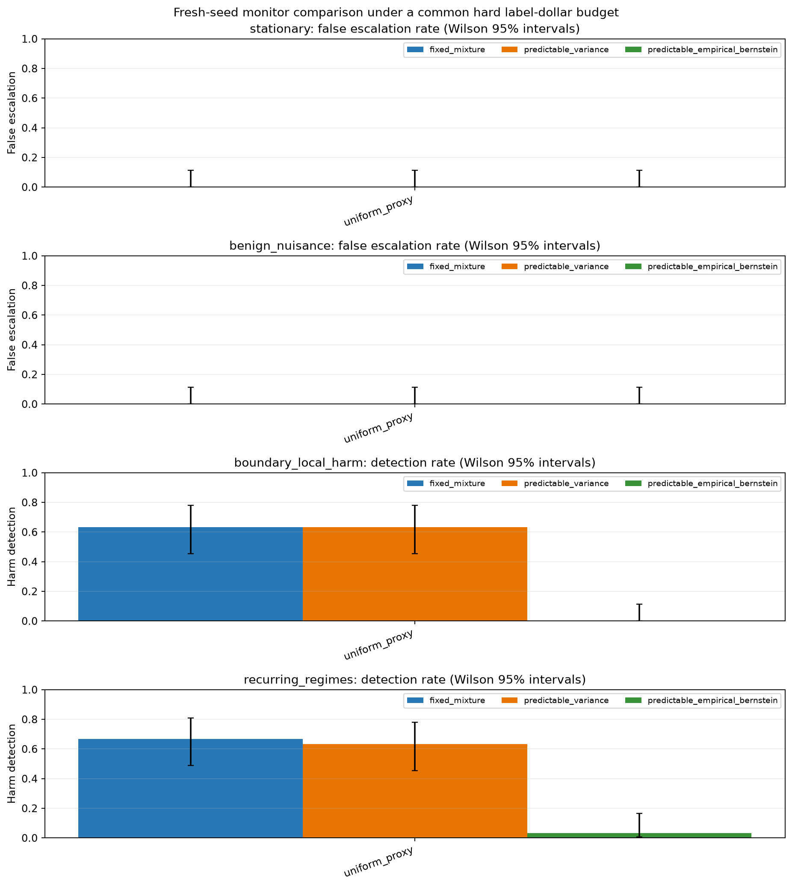

# Fresh-seed hard-budget monitor diagnostic

This is a development diagnostic following the completed budget frontier. It compares a fixed bounded-mean stake mixture with two existing predictable global-bound betting baselines: a smoothed variance-adaptive stake and predictable plug-in empirical Bernstein (PM-EB). Both comparator processes use the same prediction-powered estimate, global bound, query policy, labels, stopping rule, and alpha as the fixed mixture. Their stakes use only past evidence. These are established comparator algorithms, not novel contributions.

The run used 30 independent streams per scenario (seeds 39102026–39102055), n=3200, d=16, a 20% hard dollar cap, q_min=0.20, q_max=0.80, alpha=0.05, and the common global bound. For the selected registered scenarios, M=max(FN cost, FP cost)+margin=5.10, so the prediction-powered increment bound is M(2/q_min-1)=45.90. Requested device: `cuda`; resolved device: `NVIDIA GeForce RTX 4060 Laptop GPU`.

The primary outcomes are false escalation on stationary and benign-nuisance controls, harm detection and delay on boundary-local and recurring alternatives, onset reachability, and label spend/horizon. Report Wilson intervals and paired exact McNemar comparisons against the fixed mixture. This development grid is not a confirmation, and its small null cells cannot establish 5% calibration.

|Scenario|Query policy|Monitor|Detections / harmful|Reached / harmful|False escalations / null|Median delay given detection|Mean spend|Mean labels|Mean horizon|Paired discordants vs fixed (wins/losses)|McNemar p|
|---|---|---|---:|---:|---:|---:|---:|---:|---:|---:|---:|
|benign_nuisance|uniform_proxy|fixed_mixture|n/a|n/a|0/30|n/a|720.63|363.8|0.752|0/0|n/a|
|benign_nuisance|uniform_proxy|predictable_variance|n/a|n/a|0/30|n/a|720.63|363.8|0.752|0/0|n/a|
|benign_nuisance|uniform_proxy|predictable_empirical_bernstein|n/a|n/a|0/30|n/a|720.63|363.8|0.752|0/0|n/a|
|boundary_local_harm|uniform_proxy|fixed_mixture|19/30|30/30|n/a|1129.0|710.01|472.2|0.978|0/0|n/a|
|boundary_local_harm|uniform_proxy|predictable_variance|19/30|30/30|n/a|1191.0|710.01|472.2|0.978|0/0|1.000|
|boundary_local_harm|uniform_proxy|predictable_empirical_bernstein|0/30|30/30|n/a|n/a|710.01|472.2|0.978|0/19|0.000|
|recurring_regimes|uniform_proxy|fixed_mixture|20/30|30/30|n/a|2052.5|710.01|472.2|0.978|0/0|n/a|
|recurring_regimes|uniform_proxy|predictable_variance|19/30|30/30|n/a|2062.0|710.01|472.2|0.978|0/1|1.000|
|recurring_regimes|uniform_proxy|predictable_empirical_bernstein|1/30|30/30|n/a|2263.0|710.01|472.2|0.978|0/19|0.000|
|stationary|uniform_proxy|fixed_mixture|n/a|n/a|0/30|n/a|710.01|472.2|0.978|0/0|n/a|
|stationary|uniform_proxy|predictable_variance|n/a|n/a|0/30|n/a|710.01|472.2|0.978|0/0|n/a|
|stationary|uniform_proxy|predictable_empirical_bernstein|n/a|n/a|0/30|n/a|710.01|472.2|0.978|0/0|n/a|

Detection and false-escalation confidence intervals are in `metrics/monitor_comparison.csv`. The event-level method metrics are in `metrics/hard_budget_comparison.parquet`.

Interpret the comparison under the history-conditional mean null and the globally bounded prediction-powered increments. Do not use current-covariate-specific normalization to claim aggregate-null validity. Any monitor that looks promising requires a separate 2,000-stream null calibration and an independently seeded confirmation with a nonzero expected detection rate.

Reproduce with `uv run python scripts/diagnose_hard_budget_monitors.py --output outputs/monitor_bound_sensitivity_qmin020 --seeds 30 --seed-offset 39102026 --n 3200 --d 16 --budget-rate 0.2 --q-min 0.2 --device cuda`.