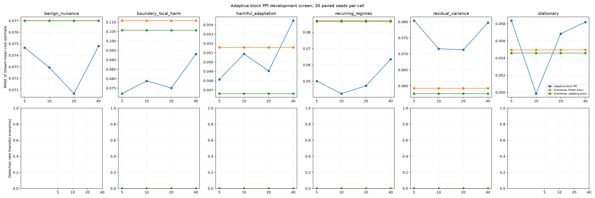

# Adaptive PPI block-size development screen

This is a development-only comparison with 30 paired seeds per scenario and block size. The null controls and four harm scenarios use the same synthetic streams, nominal 20% label-dollar budget, and frozen-proxy eventwise comparator. The eventwise updating-proxy control is included to show the effect of online proxy refitting. The percentile intervals below are paired seed-bootstrap intervals for stream-mean RMSE differences; they are exploratory and unadjusted across cells.

No method selection, false-alarm guarantee, or confirmatory conclusion should be based on this screen. Use disjoint streams for the 2,000-per-cell null calibration and separate power study.

|Block size|Scenario|Method|Streams|RMSE|Detections|False escalations|Mean spend|Mean labels|Mean events|Mean eta|
|---:|---|---|---:|---:|---:|---:|---:|---:|---:|---:|
|5|benign_nuisance|pprm_block_adaptive|30|0.0747|0/0|0/30|238.50|101.1|505.5|0.117|
|5|benign_nuisance|uniform_proxy|30|0.0770|0/0|0/30|238.56|100.8|492.3|n/a|
|5|benign_nuisance|uniform_proxy_frozen|30|0.0770|0/0|0/30|238.56|100.8|492.3|n/a|
|5|boundary_local_harm|pprm_block_adaptive|30|0.0721|0/30|0/30|236.85|157.8|789.2|0.195|
|5|boundary_local_harm|uniform_proxy|30|0.1057|0/30|0/30|233.04|155.0|765.7|n/a|
|5|boundary_local_harm|uniform_proxy_frozen|30|0.1108|0/30|0/30|233.04|155.0|765.7|n/a|
|5|harmful_adaptation|pprm_block_adaptive|30|0.0481|0/30|0/30|236.85|157.8|789.2|0.134|
|5|harmful_adaptation|uniform_proxy|30|0.0466|0/30|0/30|233.04|155.0|765.7|n/a|
|5|harmful_adaptation|uniform_proxy_frozen|30|0.0516|0/30|0/30|233.04|155.0|765.7|n/a|
|5|recurring_regimes|pprm_block_adaptive|30|0.0501|0/30|0/30|236.85|157.8|789.2|0.110|
|5|recurring_regimes|uniform_proxy|30|0.0866|0/30|0/30|233.04|155.0|765.7|n/a|
|5|recurring_regimes|uniform_proxy_frozen|30|0.0872|0/30|0/30|233.04|155.0|765.7|n/a|
|5|residual_variance|pprm_block_adaptive|30|0.0804|0/30|0/30|236.85|157.8|789.2|0.137|
|5|residual_variance|uniform_proxy|30|0.0576|0/30|0/30|233.04|155.0|765.7|n/a|
|5|residual_variance|uniform_proxy_frozen|30|0.0593|0/30|0/30|233.04|155.0|765.7|n/a|
|5|stationary|pprm_block_adaptive|30|0.0584|0/0|0/30|236.85|157.8|789.2|0.104|
|5|stationary|uniform_proxy|30|0.0546|0/0|0/30|233.04|155.0|765.7|n/a|
|5|stationary|uniform_proxy_frozen|30|0.0549|0/0|0/30|233.04|155.0|765.7|n/a|
|10|benign_nuisance|pprm_block_adaptive|30|0.0729|0/0|0/30|237.61|100.7|503.3|0.125|
|10|benign_nuisance|uniform_proxy|30|0.0770|0/0|0/30|238.56|100.8|492.3|n/a|
|10|benign_nuisance|uniform_proxy_frozen|30|0.0770|0/0|0/30|238.56|100.8|492.3|n/a|
|10|boundary_local_harm|pprm_block_adaptive|30|0.0788|0/30|0/30|235.90|157.1|785.3|0.175|
|10|boundary_local_harm|uniform_proxy|30|0.1057|0/30|0/30|233.04|155.0|765.7|n/a|
|10|boundary_local_harm|uniform_proxy_frozen|30|0.1108|0/30|0/30|233.04|155.0|765.7|n/a|
|10|harmful_adaptation|pprm_block_adaptive|30|0.0509|0/30|0/30|235.90|157.1|785.3|0.131|
|10|harmful_adaptation|uniform_proxy|30|0.0466|0/30|0/30|233.04|155.0|765.7|n/a|
|10|harmful_adaptation|uniform_proxy_frozen|30|0.0516|0/30|0/30|233.04|155.0|765.7|n/a|
|10|recurring_regimes|pprm_block_adaptive|30|0.0424|0/30|0/30|235.90|157.1|785.3|0.116|
|10|recurring_regimes|uniform_proxy|30|0.0866|0/30|0/30|233.04|155.0|765.7|n/a|
|10|recurring_regimes|uniform_proxy_frozen|30|0.0872|0/30|0/30|233.04|155.0|765.7|n/a|
|10|residual_variance|pprm_block_adaptive|30|0.0716|0/30|0/30|235.90|157.1|785.3|0.135|
|10|residual_variance|uniform_proxy|30|0.0576|0/30|0/30|233.04|155.0|765.7|n/a|
|10|residual_variance|uniform_proxy_frozen|30|0.0593|0/30|0/30|233.04|155.0|765.7|n/a|
|10|stationary|pprm_block_adaptive|30|0.0499|0/0|0/30|235.90|157.1|785.3|0.117|
|10|stationary|uniform_proxy|30|0.0546|0/0|0/30|233.04|155.0|765.7|n/a|
|10|stationary|uniform_proxy_frozen|30|0.0549|0/0|0/30|233.04|155.0|765.7|n/a|
|20|benign_nuisance|pprm_block_adaptive|30|0.0707|0/0|0/30|234.46|99.3|496.7|0.117|
|20|benign_nuisance|uniform_proxy|30|0.0770|0/0|0/30|238.56|100.8|492.3|n/a|
|20|benign_nuisance|uniform_proxy_frozen|30|0.0770|0/0|0/30|238.56|100.8|492.3|n/a|
|20|boundary_local_harm|pprm_block_adaptive|30|0.0751|0/30|0/30|232.97|154.7|773.3|0.199|
|20|boundary_local_harm|uniform_proxy|30|0.1057|0/30|0/30|233.04|155.0|765.7|n/a|
|20|boundary_local_harm|uniform_proxy_frozen|30|0.1108|0/30|0/30|233.04|155.0|765.7|n/a|
|20|harmful_adaptation|pprm_block_adaptive|30|0.0490|0/30|0/30|232.97|154.7|773.3|0.137|
|20|harmful_adaptation|uniform_proxy|30|0.0466|0/30|0/30|233.04|155.0|765.7|n/a|
|20|harmful_adaptation|uniform_proxy_frozen|30|0.0516|0/30|0/30|233.04|155.0|765.7|n/a|
|20|recurring_regimes|pprm_block_adaptive|30|0.0472|0/30|0/30|232.97|154.7|773.3|0.105|
|20|recurring_regimes|uniform_proxy|30|0.0866|0/30|0/30|233.04|155.0|765.7|n/a|
|20|recurring_regimes|uniform_proxy_frozen|30|0.0872|0/30|0/30|233.04|155.0|765.7|n/a|
|20|residual_variance|pprm_block_adaptive|30|0.0713|0/30|0/30|232.97|154.7|773.3|0.135|
|20|residual_variance|uniform_proxy|30|0.0576|0/30|0/30|233.04|155.0|765.7|n/a|
|20|residual_variance|uniform_proxy_frozen|30|0.0593|0/30|0/30|233.04|155.0|765.7|n/a|
|20|stationary|pprm_block_adaptive|30|0.0568|0/0|0/30|232.97|154.7|773.3|0.099|
|20|stationary|uniform_proxy|30|0.0546|0/0|0/30|233.04|155.0|765.7|n/a|
|20|stationary|uniform_proxy_frozen|30|0.0549|0/0|0/30|233.04|155.0|765.7|n/a|
|40|benign_nuisance|pprm_block_adaptive|30|0.0748|0/0|0/30|226.66|96.0|480.0|0.156|
|40|benign_nuisance|uniform_proxy|30|0.0770|0/0|0/30|238.56|100.8|492.3|n/a|
|40|benign_nuisance|uniform_proxy_frozen|30|0.0770|0/0|0/30|238.56|100.8|492.3|n/a|
|40|boundary_local_harm|pprm_block_adaptive|30|0.0931|0/30|0/30|224.73|149.3|746.7|0.203|
|40|boundary_local_harm|uniform_proxy|30|0.1057|0/30|0/30|233.04|155.0|765.7|n/a|
|40|boundary_local_harm|uniform_proxy_frozen|30|0.1108|0/30|0/30|233.04|155.0|765.7|n/a|
|40|harmful_adaptation|pprm_block_adaptive|30|0.0545|0/30|0/30|224.73|149.3|746.7|0.182|
|40|harmful_adaptation|uniform_proxy|30|0.0466|0/30|0/30|233.04|155.0|765.7|n/a|
|40|harmful_adaptation|uniform_proxy_frozen|30|0.0516|0/30|0/30|233.04|155.0|765.7|n/a|
|40|recurring_regimes|pprm_block_adaptive|30|0.0635|0/30|0/30|224.73|149.3|746.7|0.131|
|40|recurring_regimes|uniform_proxy|30|0.0866|0/30|0/30|233.04|155.0|765.7|n/a|
|40|recurring_regimes|uniform_proxy_frozen|30|0.0872|0/30|0/30|233.04|155.0|765.7|n/a|
|40|residual_variance|pprm_block_adaptive|30|0.0798|0/30|0/30|224.73|149.3|746.7|0.157|
|40|residual_variance|uniform_proxy|30|0.0576|0/30|0/30|233.04|155.0|765.7|n/a|
|40|residual_variance|uniform_proxy_frozen|30|0.0593|0/30|0/30|233.04|155.0|765.7|n/a|
|40|stationary|pprm_block_adaptive|30|0.0582|0/0|0/30|224.73|149.3|746.7|0.121|
|40|stationary|uniform_proxy|30|0.0546|0/0|0/30|233.04|155.0|765.7|n/a|
|40|stationary|uniform_proxy_frozen|30|0.0549|0/0|0/30|233.04|155.0|765.7|n/a|

## Paired block PPI versus frozen eventwise PPI

|Block size|Scenario|RMSE difference (95% bootstrap CI)|PPRM-only detections|Frozen-only detections|Harm reached|Spend difference|Label difference|Event difference|
|---:|---|---:|---:|---:|---:|---:|---:|---:|
|5|benign_nuisance|-0.0024 [-0.0349, 0.0274]|0|0|0/0|-0.06|0.3|13.2|
|5|boundary_local_harm|-0.0387 [-0.0972, 0.0187]|0|0|30/30|3.81|2.8|23.5|
|5|harmful_adaptation|-0.0034 [-0.0209, 0.0130]|0|0|30/30|3.81|2.8|23.5|
|5|recurring_regimes|-0.0371 [-0.0656, -0.0081]|0|0|30/30|3.81|2.8|23.5|
|5|residual_variance|0.0211 [-0.0101, 0.0523]|0|0|30/30|3.81|2.8|23.5|
|5|stationary|0.0034 [-0.0208, 0.0261]|0|0|0/0|3.81|2.8|23.5|
|10|benign_nuisance|-0.0041 [-0.0342, 0.0241]|0|0|0/0|-0.95|-0.2|11.0|
|10|boundary_local_harm|-0.0320 [-0.0918, 0.0221]|0|0|30/30|2.86|2.0|19.6|
|10|harmful_adaptation|-0.0007 [-0.0210, 0.0181]|0|0|30/30|2.86|2.0|19.6|
|10|recurring_regimes|-0.0448 [-0.0704, -0.0179]|0|0|30/30|2.86|2.0|19.6|
|10|residual_variance|0.0123 [-0.0108, 0.0364]|0|0|30/30|2.86|2.0|19.6|
|10|stationary|-0.0051 [-0.0280, 0.0168]|0|0|0/0|2.86|2.0|19.6|
|20|benign_nuisance|-0.0063 [-0.0352, 0.0207]|0|0|0/0|-4.10|-1.5|4.3|
|20|boundary_local_harm|-0.0357 [-0.0940, 0.0196]|0|0|30/30|-0.07|-0.4|7.6|
|20|harmful_adaptation|-0.0025 [-0.0208, 0.0147]|0|0|30/30|-0.07|-0.4|7.6|
|20|recurring_regimes|-0.0400 [-0.0668, -0.0121]|0|0|30/30|-0.07|-0.4|7.6|
|20|residual_variance|0.0120 [-0.0121, 0.0357]|0|0|30/30|-0.07|-0.4|7.6|
|20|stationary|0.0019 [-0.0231, 0.0261]|0|0|0/0|-0.07|-0.4|7.6|
|40|benign_nuisance|-0.0022 [-0.0313, 0.0261]|0|0|0/0|-11.90|-4.8|-12.3|
|40|boundary_local_harm|-0.0177 [-0.0793, 0.0399]|0|0|30/30|-8.31|-5.7|-19.0|
|40|harmful_adaptation|0.0029 [-0.0158, 0.0205]|0|0|30/30|-8.31|-5.7|-19.0|
|40|recurring_regimes|-0.0237 [-0.0523, 0.0052]|0|0|30/30|-8.31|-5.7|-19.0|
|40|residual_variance|0.0205 [-0.0113, 0.0511]|0|0|30/30|-8.31|-5.7|-19.0|
|40|stationary|0.0032 [-0.0195, 0.0253]|0|0|0/0|-8.31|-5.7|-19.0|

