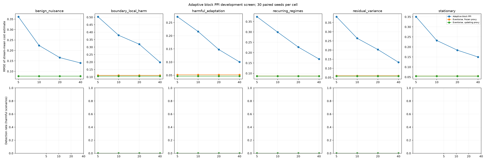

# Adaptive PPI block-size development screen

This is a development-only comparison with 30 paired seeds per scenario and block size. The null controls and four harm scenarios use the same synthetic streams, nominal 20% label-dollar budget, and frozen-proxy eventwise comparator. The eventwise updating-proxy control is included to show the effect of online proxy refitting. The percentile intervals below are paired seed-bootstrap intervals for stream-mean RMSE differences; they are exploratory and unadjusted across cells.

No method selection, false-alarm guarantee, or confirmatory conclusion should be based on this screen. Use disjoint streams for the 2,000-per-cell null calibration and separate power study.

|Block size|Scenario|Method|Streams|RMSE|Detections|False escalations|Mean spend|Mean labels|Mean events|Mean eta|
|---:|---|---|---:|---:|---:|---:|---:|---:|---:|---:|
|5|benign_nuisance|pprm_block_adaptive|30|0.3616|0/0|0/30|238.50|101.1|505.5|0.052|
|5|benign_nuisance|uniform_proxy|30|0.0770|0/0|0/30|238.56|100.8|492.3|n/a|
|5|benign_nuisance|uniform_proxy_frozen|30|0.0770|0/0|0/30|238.56|100.8|492.3|n/a|
|5|boundary_local_harm|pprm_block_adaptive|30|0.5033|0/30|0/30|236.85|157.8|789.2|0.058|
|5|boundary_local_harm|uniform_proxy|30|0.1057|0/30|0/30|233.04|155.0|765.7|n/a|
|5|boundary_local_harm|uniform_proxy_frozen|30|0.1108|0/30|0/30|233.04|155.0|765.7|n/a|
|5|harmful_adaptation|pprm_block_adaptive|30|0.2723|0/30|0/30|236.85|157.8|789.2|0.107|
|5|harmful_adaptation|uniform_proxy|30|0.0466|0/30|0/30|233.04|155.0|765.7|n/a|
|5|harmful_adaptation|uniform_proxy_frozen|30|0.0516|0/30|0/30|233.04|155.0|765.7|n/a|
|5|recurring_regimes|pprm_block_adaptive|30|0.3735|0/30|0/30|236.85|157.8|789.2|0.043|
|5|recurring_regimes|uniform_proxy|30|0.0866|0/30|0/30|233.04|155.0|765.7|n/a|
|5|recurring_regimes|uniform_proxy_frozen|30|0.0872|0/30|0/30|233.04|155.0|765.7|n/a|
|5|residual_variance|pprm_block_adaptive|30|0.3824|0/30|0/30|236.85|157.8|789.2|0.050|
|5|residual_variance|uniform_proxy|30|0.0576|0/30|0/30|233.04|155.0|765.7|n/a|
|5|residual_variance|uniform_proxy_frozen|30|0.0593|0/30|0/30|233.04|155.0|765.7|n/a|
|5|stationary|pprm_block_adaptive|30|0.3506|0/0|0/30|236.85|157.8|789.2|0.043|
|5|stationary|uniform_proxy|30|0.0546|0/0|0/30|233.04|155.0|765.7|n/a|
|5|stationary|uniform_proxy_frozen|30|0.0549|0/0|0/30|233.04|155.0|765.7|n/a|
|10|benign_nuisance|pprm_block_adaptive|30|0.2238|0/0|0/30|237.61|100.7|503.3|0.076|
|10|benign_nuisance|uniform_proxy|30|0.0770|0/0|0/30|238.56|100.8|492.3|n/a|
|10|benign_nuisance|uniform_proxy_frozen|30|0.0770|0/0|0/30|238.56|100.8|492.3|n/a|
|10|boundary_local_harm|pprm_block_adaptive|30|0.3792|0/30|0/30|235.90|157.1|785.3|0.160|
|10|boundary_local_harm|uniform_proxy|30|0.1057|0/30|0/30|233.04|155.0|765.7|n/a|
|10|boundary_local_harm|uniform_proxy_frozen|30|0.1108|0/30|0/30|233.04|155.0|765.7|n/a|
|10|harmful_adaptation|pprm_block_adaptive|30|0.2160|0/30|0/30|235.90|157.1|785.3|0.103|
|10|harmful_adaptation|uniform_proxy|30|0.0466|0/30|0/30|233.04|155.0|765.7|n/a|
|10|harmful_adaptation|uniform_proxy_frozen|30|0.0516|0/30|0/30|233.04|155.0|765.7|n/a|
|10|recurring_regimes|pprm_block_adaptive|30|0.2990|0/30|0/30|235.90|157.1|785.3|0.056|
|10|recurring_regimes|uniform_proxy|30|0.0866|0/30|0/30|233.04|155.0|765.7|n/a|
|10|recurring_regimes|uniform_proxy_frozen|30|0.0872|0/30|0/30|233.04|155.0|765.7|n/a|
|10|residual_variance|pprm_block_adaptive|30|0.2645|0/30|0/30|235.90|157.1|785.3|0.090|
|10|residual_variance|uniform_proxy|30|0.0576|0/30|0/30|233.04|155.0|765.7|n/a|
|10|residual_variance|uniform_proxy_frozen|30|0.0593|0/30|0/30|233.04|155.0|765.7|n/a|
|10|stationary|pprm_block_adaptive|30|0.2324|0/0|0/30|235.90|157.1|785.3|0.056|
|10|stationary|uniform_proxy|30|0.0546|0/0|0/30|233.04|155.0|765.7|n/a|
|10|stationary|uniform_proxy_frozen|30|0.0549|0/0|0/30|233.04|155.0|765.7|n/a|
|20|benign_nuisance|pprm_block_adaptive|30|0.1656|0/0|0/30|234.46|99.3|496.7|0.138|
|20|benign_nuisance|uniform_proxy|30|0.0770|0/0|0/30|238.56|100.8|492.3|n/a|
|20|benign_nuisance|uniform_proxy_frozen|30|0.0770|0/0|0/30|238.56|100.8|492.3|n/a|
|20|boundary_local_harm|pprm_block_adaptive|30|0.3192|0/30|0/30|232.97|154.7|773.3|0.216|
|20|boundary_local_harm|uniform_proxy|30|0.1057|0/30|0/30|233.04|155.0|765.7|n/a|
|20|boundary_local_harm|uniform_proxy_frozen|30|0.1108|0/30|0/30|233.04|155.0|765.7|n/a|
|20|harmful_adaptation|pprm_block_adaptive|30|0.1476|0/30|0/30|232.97|154.7|773.3|0.112|
|20|harmful_adaptation|uniform_proxy|30|0.0466|0/30|0/30|233.04|155.0|765.7|n/a|
|20|harmful_adaptation|uniform_proxy_frozen|30|0.0516|0/30|0/30|233.04|155.0|765.7|n/a|
|20|recurring_regimes|pprm_block_adaptive|30|0.2267|0/30|0/30|232.97|154.7|773.3|0.113|
|20|recurring_regimes|uniform_proxy|30|0.0866|0/30|0/30|233.04|155.0|765.7|n/a|
|20|recurring_regimes|uniform_proxy_frozen|30|0.0872|0/30|0/30|233.04|155.0|765.7|n/a|
|20|residual_variance|pprm_block_adaptive|30|0.2029|0/30|0/30|232.97|154.7|773.3|0.164|
|20|residual_variance|uniform_proxy|30|0.0576|0/30|0/30|233.04|155.0|765.7|n/a|
|20|residual_variance|uniform_proxy_frozen|30|0.0593|0/30|0/30|233.04|155.0|765.7|n/a|
|20|stationary|pprm_block_adaptive|30|0.1838|0/0|0/30|232.97|154.7|773.3|0.113|
|20|stationary|uniform_proxy|30|0.0546|0/0|0/30|233.04|155.0|765.7|n/a|
|20|stationary|uniform_proxy_frozen|30|0.0549|0/0|0/30|233.04|155.0|765.7|n/a|
|40|benign_nuisance|pprm_block_adaptive|30|0.1400|0/0|0/30|226.66|96.0|480.0|0.191|
|40|benign_nuisance|uniform_proxy|30|0.0770|0/0|0/30|238.56|100.8|492.3|n/a|
|40|benign_nuisance|uniform_proxy_frozen|30|0.0770|0/0|0/30|238.56|100.8|492.3|n/a|
|40|boundary_local_harm|pprm_block_adaptive|30|0.1984|0/30|0/30|224.73|149.3|746.7|0.216|
|40|boundary_local_harm|uniform_proxy|30|0.1057|0/30|0/30|233.04|155.0|765.7|n/a|
|40|boundary_local_harm|uniform_proxy_frozen|30|0.1108|0/30|0/30|233.04|155.0|765.7|n/a|
|40|harmful_adaptation|pprm_block_adaptive|30|0.1004|0/30|0/30|224.73|149.3|746.7|0.176|
|40|harmful_adaptation|uniform_proxy|30|0.0466|0/30|0/30|233.04|155.0|765.7|n/a|
|40|harmful_adaptation|uniform_proxy_frozen|30|0.0516|0/30|0/30|233.04|155.0|765.7|n/a|
|40|recurring_regimes|pprm_block_adaptive|30|0.1691|0/30|0/30|224.73|149.3|746.7|0.163|
|40|recurring_regimes|uniform_proxy|30|0.0866|0/30|0/30|233.04|155.0|765.7|n/a|
|40|recurring_regimes|uniform_proxy_frozen|30|0.0872|0/30|0/30|233.04|155.0|765.7|n/a|
|40|residual_variance|pprm_block_adaptive|30|0.1331|0/30|0/30|224.73|149.3|746.7|0.176|
|40|residual_variance|uniform_proxy|30|0.0576|0/30|0/30|233.04|155.0|765.7|n/a|
|40|residual_variance|uniform_proxy_frozen|30|0.0593|0/30|0/30|233.04|155.0|765.7|n/a|
|40|stationary|pprm_block_adaptive|30|0.1498|0/0|0/30|224.73|149.3|746.7|0.163|
|40|stationary|uniform_proxy|30|0.0546|0/0|0/30|233.04|155.0|765.7|n/a|
|40|stationary|uniform_proxy_frozen|30|0.0549|0/0|0/30|233.04|155.0|765.7|n/a|

## Paired block PPI versus frozen eventwise PPI

|Block size|Scenario|RMSE difference (95% bootstrap CI)|PPRM-only detections|Frozen-only detections|Harm reached|Spend difference|Label difference|Event difference|
|---:|---|---:|---:|---:|---:|---:|---:|---:|
|5|benign_nuisance|0.2845 [0.0950, 0.4444]|0|0|0/0|-0.06|0.3|13.2|
|5|boundary_local_harm|0.3925 [0.2829, 0.5224]|0|0|30/30|3.81|2.8|23.5|
|5|harmful_adaptation|0.2207 [0.1545, 0.2829]|0|0|30/30|3.81|2.8|23.5|
|5|recurring_regimes|0.2864 [0.1865, 0.3900]|0|0|30/30|3.81|2.8|23.5|
|5|residual_variance|0.3231 [0.1761, 0.4467]|0|0|30/30|3.81|2.8|23.5|
|5|stationary|0.2956 [0.1080, 0.4446]|0|0|0/0|3.81|2.8|23.5|
|10|benign_nuisance|0.1468 [0.0932, 0.2030]|0|0|0/0|-0.95|-0.2|11.0|
|10|boundary_local_harm|0.2684 [0.1600, 0.3746]|0|0|30/30|2.86|2.0|19.6|
|10|harmful_adaptation|0.1644 [0.0986, 0.2259]|0|0|30/30|2.86|2.0|19.6|
|10|recurring_regimes|0.2119 [0.1757, 0.2514]|0|0|30/30|2.86|2.0|19.6|
|10|residual_variance|0.2052 [0.1655, 0.2445]|0|0|30/30|2.86|2.0|19.6|
|10|stationary|0.1774 [0.1224, 0.2327]|0|0|0/0|2.86|2.0|19.6|
|20|benign_nuisance|0.0886 [0.0464, 0.1265]|0|0|0/0|-4.10|-1.5|4.3|
|20|boundary_local_harm|0.2084 [0.1248, 0.3044]|0|0|30/30|-0.07|-0.4|7.6|
|20|harmful_adaptation|0.0960 [0.0640, 0.1286]|0|0|30/30|-0.07|-0.4|7.6|
|20|recurring_regimes|0.1396 [0.0921, 0.1873]|0|0|30/30|-0.07|-0.4|7.6|
|20|residual_variance|0.1437 [0.0940, 0.1949]|0|0|30/30|-0.07|-0.4|7.6|
|20|stationary|0.1289 [0.0887, 0.1666]|0|0|0/0|-0.07|-0.4|7.6|
|40|benign_nuisance|0.0629 [0.0209, 0.1011]|0|0|0/0|-11.90|-4.8|-12.3|
|40|boundary_local_harm|0.0875 [0.0147, 0.1591]|0|0|30/30|-8.31|-5.7|-19.0|
|40|harmful_adaptation|0.0489 [0.0273, 0.0713]|0|0|30/30|-8.31|-5.7|-19.0|
|40|recurring_regimes|0.0819 [0.0315, 0.1334]|0|0|30/30|-8.31|-5.7|-19.0|
|40|residual_variance|0.0738 [0.0419, 0.1068]|0|0|30/30|-8.31|-5.7|-19.0|
|40|stationary|0.0949 [0.0527, 0.1348]|0|0|0/0|-8.31|-5.7|-19.0|

