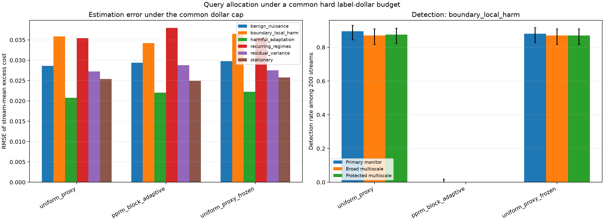

# Common hard label-dollar budget comparison

Evaluated 200 seeds per scenario on `cuda`. Every policy received the same per-stream dollar cap, calibrated from the mean tariff in the pre-monitor validation slice. Methods share per-seed uniform random variates to enable paired comparisons. The maximum tariff support is fixed at 2.5; the monitor stops before the next event once the remaining balance is below that support maximum. This makes every processed event's query propensity positive and predictable, while ensuring spend never exceeds the cap.

The eventwise e-process monitors use the common configured propensity floor in their support bound; the PPRM-style block confidence sequence instead uses its declared fixed block support.

Each monitor is evaluated only through its budget stopping time. Harm detection is reported both over evaluator-labeled alternative streams and over harmful streams whose onset occurred before budget stopping; the latter avoids calling an unobserved late onset a monitor miss. Stationary and benign-nuisance controls are population nulls; finite-stream oracle flags are reported separately and every alarm on these controls counts as a false escalation. Stream seeds are the inferential units. The outcomes and tariffs are synthetic; current and reference policy costs are paired on the same label.

|Scenario|Method|Mean cap|Mean spend|Mean cap use|Mean labels|Monitor fraction|Stream-mean RMSE|Harm reached / harmful streams|Pathwise oracle flags|Primary detection all / reached|Multiscale detection all / reached|Protected detection all / reached|Primary / multiscale / protected false escalation|
|---|---|---:|---:|---:|---:|---:|---:|---:|---:|---:|---:|---:|
|benign_nuisance|pprm_block_adaptive|1439.08|1433.75|0.996|723.9|0.754|0.0294|0/0|2|n/a / n/a|n/a / n/a|n/a / n/a|0.000 / 0.000 / 0.000|
|benign_nuisance|uniform_proxy|1439.08|1437.82|0.999|725.6|0.756|0.0286|0/0|2|n/a / n/a|n/a / n/a|n/a / n/a|0.000 / 0.000 / 0.000|
|benign_nuisance|uniform_proxy_frozen|1439.08|1437.82|0.999|725.6|0.756|0.0298|0/0|2|n/a / n/a|n/a / n/a|n/a / n/a|0.000 / 0.000 / 0.000|
|boundary_local_harm|pprm_block_adaptive|1439.08|1427.39|0.992|952.2|0.992|0.0342|200/200|200|0.000 / 0.000|n/a / n/a|n/a / n/a|0.000 / n/a / n/a|
|boundary_local_harm|uniform_proxy|1439.08|1417.78|0.985|945.4|0.986|0.0359|200/200|200|0.895 / 0.895|0.870 / 0.870|0.875 / 0.875|0.000 / 0.000 / 0.000|
|boundary_local_harm|uniform_proxy_frozen|1439.08|1417.78|0.985|945.4|0.986|0.0365|200/200|200|0.880 / 0.880|0.870 / 0.870|0.870 / 0.870|0.000 / 0.000 / 0.000|
|harmful_adaptation|pprm_block_adaptive|1439.08|1427.39|0.992|952.2|0.992|0.0220|200/200|200|0.000 / 0.000|n/a / n/a|n/a / n/a|0.000 / n/a / n/a|
|harmful_adaptation|uniform_proxy|1439.08|1417.78|0.985|945.4|0.986|0.0208|200/200|200|0.970 / 0.970|0.970 / 0.970|0.970 / 0.970|0.000 / 0.000 / 0.000|
|harmful_adaptation|uniform_proxy_frozen|1439.08|1417.78|0.985|945.4|0.986|0.0222|200/200|200|0.955 / 0.955|0.955 / 0.955|0.955 / 0.955|0.000 / 0.000 / 0.000|
|recurring_regimes|pprm_block_adaptive|1439.08|1427.39|0.992|952.2|0.992|0.0379|200/200|200|0.000 / 0.000|n/a / n/a|n/a / n/a|0.000 / n/a / n/a|
|recurring_regimes|uniform_proxy|1439.08|1417.78|0.985|945.4|0.986|0.0354|200/200|200|0.860 / 0.860|0.845 / 0.845|0.845 / 0.845|0.000 / 0.000 / 0.000|
|recurring_regimes|uniform_proxy_frozen|1439.08|1417.78|0.985|945.4|0.986|0.0356|200/200|200|0.860 / 0.860|0.845 / 0.845|0.845 / 0.845|0.000 / 0.000 / 0.000|
|residual_variance|pprm_block_adaptive|1439.08|1427.39|0.992|952.2|0.992|0.0288|200/200|200|0.000 / 0.000|n/a / n/a|n/a / n/a|0.000 / n/a / n/a|
|residual_variance|uniform_proxy|1439.08|1417.78|0.985|945.4|0.986|0.0273|200/200|200|0.000 / 0.000|0.000 / 0.000|0.000 / 0.000|0.000 / 0.000 / 0.000|
|residual_variance|uniform_proxy_frozen|1439.08|1417.78|0.985|945.4|0.986|0.0275|200/200|200|0.000 / 0.000|0.000 / 0.000|0.000 / 0.000|0.000 / 0.000 / 0.000|
|stationary|pprm_block_adaptive|1439.08|1427.39|0.992|952.2|0.992|0.0250|0/0|0|n/a / n/a|n/a / n/a|n/a / n/a|0.000 / 0.000 / 0.000|
|stationary|uniform_proxy|1439.08|1417.78|0.985|945.4|0.986|0.0254|0/0|0|n/a / n/a|n/a / n/a|n/a / n/a|0.000 / 0.000 / 0.000|
|stationary|uniform_proxy_frozen|1439.08|1417.78|0.985|945.4|0.986|0.0258|0/0|0|n/a / n/a|n/a / n/a|n/a / n/a|0.000 / 0.000 / 0.000|

## Full-horizon consistency check

Each monitor is evaluated only through its hard-budget stopping time. The eventwise monitors are e-processes; the PPI block comparator is a Hoeffding-mixture confidence sequence for the running average of predictable block means. It does not reproduce PPRM's empirical-Bernstein bound. Any comparison with a full-monitor baseline must use matching stream seeds and query random numbers.

The fixed-stake baseline uses (0.05, 0.10, 0.20, 0.40, 0.80). The multiscale comparator uses 13 equally weighted geometric stakes from 1/1024 to 0.99. Both are fixed mixtures of factors `1 + eta * X / B`; under the same predictable conditional-mean null and `|X| <= B`, each mixture remains an e-process. The multiscale comparator is a predeclared robustness baseline, not a new validity theorem.
The protected mixture assigns 0.90 total initial weight equally to the five fixed stakes and 0.10 equally to eight geometric stakes from 1/1024 to 0.04. Its weights and support are fixed before evaluation, so it has the same e-process guarantee; it tests whether preserving baseline mass avoids dilution while retaining smaller-scale sensitivity.

## Interpretation limits

This is an allocation and monitor comparison under a finite spend cap, not an intervention controller or a new theorem. The hard-cap stopping time is based on past realized spend, not current evaluator truth. Eventwise e-process validity requires the documented bounded-increment conditional-mean null and predictable query probabilities. The PPI block confidence sequence assumes bounded block estimates and valid predictable block means; its Hoeffding boundary is conservative and does not provide PPRM's empirical-Bernstein efficiency. Early budget exhaustion censors later harm onsets; report both reachability and detection. Realized label dollars are bounded, while the number of labels and monitor horizon remain random. The saved sum of per-event `q_t * cost_t` is a predictable-spend compensator along the realized stopping path; its pathwise sum can exceed the hard cap and it must not be read as realized spend.

Reproduce with `uv run shiftlab-dive-hard-budget --seeds 200 --seed-offset 20373000 --n 6400 --d 16 --budget-rate 0.2 --q-min 0.1 --q-max 0.8 --device cuda --exact-growth-adaptive-weight 1.0 --robust-growth-probability-radius 0.0 --pprm-block-size 20 --pprm-labels-per-block 4 --pprm-max-reliance 0.1 --pprm-initial-reliance 0.1 --scenarios stationary benign_nuisance boundary_local_harm residual_variance recurring_regimes harmful_adaptation --methods uniform_proxy uniform_proxy_frozen pprm_block_adaptive --common-eprocess-bound --output outputs/pprm_block_mixture_independent_v1/block_20`.

## Paired comparison against uniform sampling

RMSE intervals are paired percentile bootstraps over independent seeds (20,000 resamples). Spend, label-count and monitor-fraction intervals are paired t intervals. They are descriptive and do not adjust for selecting a method after seeing this grid.

|Scenario|Method|RMSE difference (95% bootstrap CI)|Spend difference (95% t CI)|Label difference (95% t CI)|Monitor-fraction difference (95% t CI)|Primary / multiscale / protected detections / reached|Multiscale-only / primary-only|Protected-only / primary-only|Protected false escalations / streams|
|---|---|---:|---:|---:|---:|---:|---:|---:|---:|
|benign_nuisance|pprm_block_adaptive|0.0008 [-0.0031, 0.0047]|-4.06 [-4.46, -3.67]|-1.7 [-2.7, -0.8]|-0.002 [-0.006, 0.001]|0 / n/a / n/a / 0|n/a / n/a|n/a / n/a|n/a / 200|
|benign_nuisance|uniform_proxy_frozen|0.0012 [0.0001, 0.0023]|0.00 [0.00, 0.00]|0.0 [0.0, 0.0]|0.000 [0.000, 0.000]|0 / 0 / 0 / 0|0 / 0|0 / 0|0 / 200|
|boundary_local_harm|pprm_block_adaptive|-0.0017 [-0.0066, 0.0034]|9.61 [5.77, 13.46]|6.8 [4.3, 9.3]|0.006 [0.003, 0.009]|0 / n/a / n/a / 200|n/a / n/a|n/a / n/a|n/a / 200|
|boundary_local_harm|uniform_proxy_frozen|0.0006 [0.0002, 0.0011]|0.00 [0.00, 0.00]|0.0 [0.0, 0.0]|0.000 [0.000, 0.000]|176 / 174 / 174 / 200|0 / 2|0 / 2|0 / 200|
|harmful_adaptation|pprm_block_adaptive|0.0012 [-0.0018, 0.0042]|9.61 [5.77, 13.46]|6.8 [4.3, 9.3]|0.006 [0.003, 0.009]|0 / n/a / n/a / 200|n/a / n/a|n/a / n/a|n/a / 200|
|harmful_adaptation|uniform_proxy_frozen|0.0015 [0.0010, 0.0019]|0.00 [0.00, 0.00]|0.0 [0.0, 0.0]|0.000 [0.000, 0.000]|191 / 191 / 191 / 200|0 / 0|0 / 0|0 / 200|
|recurring_regimes|pprm_block_adaptive|0.0025 [-0.0026, 0.0077]|9.61 [5.77, 13.46]|6.8 [4.3, 9.3]|0.006 [0.003, 0.009]|0 / n/a / n/a / 200|n/a / n/a|n/a / n/a|n/a / 200|
|recurring_regimes|uniform_proxy_frozen|0.0002 [-0.0003, 0.0007]|0.00 [0.00, 0.00]|0.0 [0.0, 0.0]|0.000 [0.000, 0.000]|172 / 169 / 169 / 200|0 / 3|0 / 3|0 / 200|
|residual_variance|pprm_block_adaptive|0.0015 [-0.0019, 0.0049]|9.61 [5.77, 13.46]|6.8 [4.3, 9.3]|0.006 [0.003, 0.009]|0 / n/a / n/a / 200|n/a / n/a|n/a / n/a|n/a / 200|
|residual_variance|uniform_proxy_frozen|0.0002 [-0.0001, 0.0006]|0.00 [0.00, 0.00]|0.0 [0.0, 0.0]|0.000 [0.000, 0.000]|0 / 0 / 0 / 200|0 / 0|0 / 0|0 / 200|
|stationary|pprm_block_adaptive|-0.0004 [-0.0034, 0.0025]|9.61 [5.77, 13.46]|6.8 [4.3, 9.3]|0.006 [0.003, 0.009]|0 / n/a / n/a / 0|n/a / n/a|n/a / n/a|n/a / 200|
|stationary|uniform_proxy_frozen|0.0004 [0.0001, 0.0007]|0.00 [0.00, 0.00]|0.0 [0.0, 0.0]|0.000 [0.000, 0.000]|0 / 0 / 0 / 0|0 / 0|0 / 0|0 / 200|
