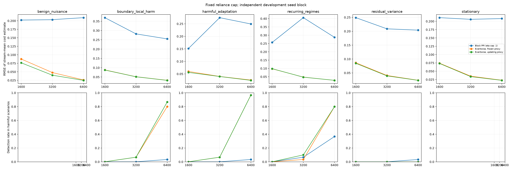

# PPI horizon sensitivity

Development-only experiment on a seed block disjoint from the earlier block-size and reliance-cap screens. The block PPI configuration is held at B=20, 4 labels per block, max/initial reliance 0.1, alpha 0.05, and a nominal 20% label-dollar budget. The eventwise frozen and updating proxy controls run on the same seed/scenario streams. These results do not calibrate false alarms or establish confirmatory power.

|Horizon n|Scenario|Method|Streams|Harm reached|Detected|False escalations|RMSE|Mean true harm|Mean CS lower bound|Mean events|
|---:|---|---|---:|---:|---:|---:|---:|---:|---:|---:|
|1600|benign_nuisance|pprm_block_adaptive|30|0/0|0/0|0/30|0.2022|0.0758|0.188|498.0|
|1600|benign_nuisance|uniform_proxy|30|0/0|0/0|0/30|0.0765|0.0767|n/a|512.6|
|1600|benign_nuisance|uniform_proxy_frozen|30|0/0|0/0|0/30|0.0877|0.0767|n/a|512.6|
|1600|boundary_local_harm|pprm_block_adaptive|30|30/30|0/30|0/30|0.3693|0.3763|0.330|776.7|
|1600|boundary_local_harm|uniform_proxy|30|30/30|0/30|0/30|0.0876|0.3781|n/a|776.2|
|1600|boundary_local_harm|uniform_proxy_frozen|30|30/30|0/30|0/30|0.0883|0.3781|n/a|776.2|
|1600|harmful_adaptation|pprm_block_adaptive|30|30/30|0/30|0/30|0.1515|0.3694|0.332|776.7|
|1600|harmful_adaptation|uniform_proxy|30|30/30|0/30|0/30|0.0561|0.3693|n/a|776.2|
|1600|harmful_adaptation|uniform_proxy_frozen|30|30/30|0/30|0/30|0.0598|0.3693|n/a|776.2|
|1600|recurring_regimes|pprm_block_adaptive|30|30/30|0/30|0/30|0.2566|0.2231|0.303|776.7|
|1600|recurring_regimes|uniform_proxy|30|30/30|0/30|0/30|0.0985|0.2247|n/a|776.2|
|1600|recurring_regimes|uniform_proxy_frozen|30|30/30|0/30|0/30|0.0978|0.2247|n/a|776.2|
|1600|residual_variance|pprm_block_adaptive|30|30/30|0/30|0/30|0.2489|0.1309|0.307|776.7|
|1600|residual_variance|uniform_proxy|30|30/30|0/30|0/30|0.0846|0.1316|n/a|776.2|
|1600|residual_variance|uniform_proxy_frozen|30|30/30|0/30|0/30|0.0866|0.1316|n/a|776.2|
|1600|stationary|pprm_block_adaptive|30|0/0|0/0|0/30|0.2109|0.0778|0.303|776.7|
|1600|stationary|uniform_proxy|30|0/0|0/0|0/30|0.0734|0.0781|n/a|776.2|
|1600|stationary|uniform_proxy_frozen|30|0/0|0/0|0/30|0.0743|0.0781|n/a|776.2|
|3200|benign_nuisance|pprm_block_adaptive|30|0/0|0/0|0/30|0.2034|0.0789|0.418|1806.0|
|3200|benign_nuisance|uniform_proxy|30|0/0|0/0|0/30|0.0401|0.0784|n/a|1845.2|
|3200|benign_nuisance|uniform_proxy_frozen|30|0/0|0/0|0/30|0.0478|0.0784|n/a|1845.2|
|3200|boundary_local_harm|pprm_block_adaptive|30|30/30|0/30|0/30|0.2820|0.2809|0.440|2374.7|
|3200|boundary_local_harm|uniform_proxy|30|30/30|2/30|0/30|0.0512|0.2796|n/a|2367.8|
|3200|boundary_local_harm|uniform_proxy_frozen|30|30/30|2/30|0/30|0.0515|0.2796|n/a|2367.8|
|3200|harmful_adaptation|pprm_block_adaptive|30|30/30|0/30|0/30|0.2745|0.2707|0.440|2374.7|
|3200|harmful_adaptation|uniform_proxy|30|30/30|2/30|0/30|0.0396|0.2703|n/a|2367.8|
|3200|harmful_adaptation|uniform_proxy_frozen|30|30/30|2/30|0/30|0.0399|0.2703|n/a|2367.8|
|3200|recurring_regimes|pprm_block_adaptive|30|30/30|2/30|0/30|0.4057|0.2805|0.467|2374.7|
|3200|recurring_regimes|uniform_proxy|30|30/30|3/30|0/30|0.0474|0.2791|n/a|2367.8|
|3200|recurring_regimes|uniform_proxy_frozen|30|30/30|1/30|0/30|0.0477|0.2791|n/a|2367.8|
|3200|residual_variance|pprm_block_adaptive|30|30/30|0/30|0/30|0.2087|0.1150|0.440|2374.7|
|3200|residual_variance|uniform_proxy|30|30/30|0/30|0/30|0.0393|0.1145|n/a|2367.8|
|3200|residual_variance|uniform_proxy_frozen|30|30/30|0/30|0/30|0.0407|0.1145|n/a|2367.8|
|3200|stationary|pprm_block_adaptive|30|0/0|0/0|0/30|0.2059|0.0796|0.440|2374.7|
|3200|stationary|uniform_proxy|30|0/0|0/0|0/30|0.0338|0.0794|n/a|2367.8|
|3200|stationary|uniform_proxy_frozen|30|0/0|0/0|0/30|0.0352|0.0794|n/a|2367.8|
|6400|benign_nuisance|pprm_block_adaptive|30|0/0|0/0|0/30|0.2092|0.0795|0.465|3627.3|
|6400|benign_nuisance|uniform_proxy|30|0/0|0/0|0/30|0.0249|0.0795|n/a|3655.0|
|6400|benign_nuisance|uniform_proxy_frozen|30|0/0|0/0|0/30|0.0262|0.0795|n/a|3655.0|
|6400|boundary_local_harm|pprm_block_adaptive|30|30/30|1/30|0/30|0.2551|0.2775|0.476|4768.7|
|6400|boundary_local_harm|uniform_proxy|30|30/30|26/30|0/30|0.0320|0.2774|n/a|4749.7|
|6400|boundary_local_harm|uniform_proxy_frozen|30|30/30|24/30|0/30|0.0325|0.2774|n/a|4749.7|
|6400|harmful_adaptation|pprm_block_adaptive|30|30/30|1/30|0/30|0.2494|0.2727|0.476|4768.7|
|6400|harmful_adaptation|uniform_proxy|30|30/30|29/30|0/30|0.0243|0.2723|n/a|4749.7|
|6400|harmful_adaptation|uniform_proxy_frozen|30|30/30|29/30|0/30|0.0255|0.2723|n/a|4749.7|
|6400|recurring_regimes|pprm_block_adaptive|30|30/30|11/30|0/30|0.2872|0.2771|0.502|4768.7|
|6400|recurring_regimes|uniform_proxy|30|30/30|24/30|0/30|0.0283|0.2771|n/a|4749.7|
|6400|recurring_regimes|uniform_proxy_frozen|30|30/30|24/30|0/30|0.0281|0.2771|n/a|4749.7|
|6400|residual_variance|pprm_block_adaptive|30|30/30|1/30|0/30|0.2040|0.1143|0.476|4768.7|
|6400|residual_variance|uniform_proxy|30|30/30|0/30|0/30|0.0231|0.1143|n/a|4749.7|
|6400|residual_variance|uniform_proxy_frozen|30|30/30|0/30|0/30|0.0235|0.1143|n/a|4749.7|
|6400|stationary|pprm_block_adaptive|30|0/0|0/0|1/30|0.2082|0.0791|0.476|4768.7|
|6400|stationary|uniform_proxy|30|0/0|0/0|0/30|0.0225|0.0792|n/a|4749.7|
|6400|stationary|uniform_proxy_frozen|30|0/0|0/0|0/30|0.0230|0.0792|n/a|4749.7|

