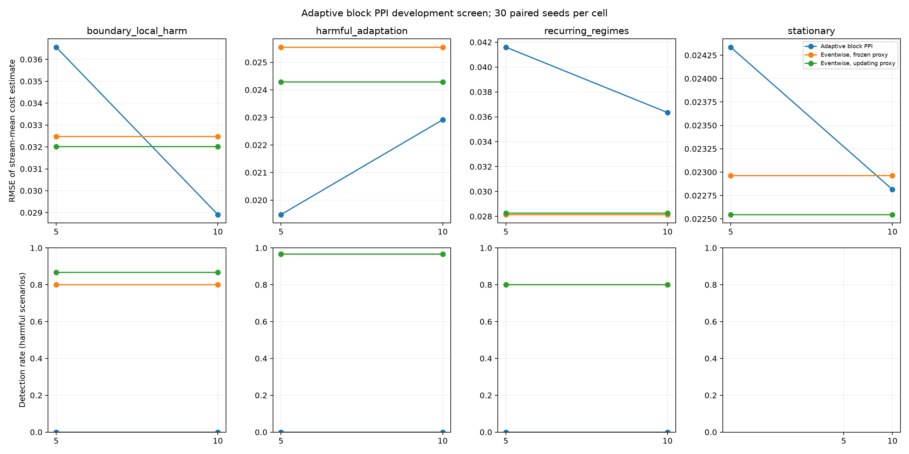

# Adaptive PPI block-size development screen

This is a development-only comparison with 30 paired seeds per scenario and block size. The null controls and four harm scenarios use the same synthetic streams, nominal 20% label-dollar budget, and frozen-proxy eventwise comparator. The eventwise updating-proxy control is included to show the effect of online proxy refitting. The percentile intervals below are paired seed-bootstrap intervals for stream-mean RMSE differences; they are exploratory and unadjusted across cells.

No method selection, false-alarm guarantee, or confirmatory conclusion should be based on this screen. Use disjoint streams for the 2,000-per-cell null calibration and separate power study.

|Block size|Scenario|Method|Streams|RMSE|Detections|False escalations|Mean spend|Mean labels|Mean events|Mean eta|
|---:|---|---|---:|---:|---:|---:|---:|---:|---:|---:|
|5|boundary_local_harm|pprm_block_adaptive|30|0.0366|0/30|0/30|1429.49|955.5|4777.7|0.110|
|5|boundary_local_harm|uniform_proxy|30|0.0320|26/30|0/30|1412.43|943.7|4749.7|n/a|
|5|boundary_local_harm|uniform_proxy_frozen|30|0.0325|24/30|0/30|1412.43|943.7|4749.7|n/a|
|5|harmful_adaptation|pprm_block_adaptive|30|0.0195|0/30|0/30|1429.49|955.5|4777.7|0.122|
|5|harmful_adaptation|uniform_proxy|30|0.0243|29/30|0/30|1412.43|943.7|4749.7|n/a|
|5|harmful_adaptation|uniform_proxy_frozen|30|0.0255|29/30|0/30|1412.43|943.7|4749.7|n/a|
|5|recurring_regimes|pprm_block_adaptive|30|0.0416|0/30|0/30|1429.49|955.5|4777.7|0.138|
|5|recurring_regimes|uniform_proxy|30|0.0283|24/30|0/30|1412.43|943.7|4749.7|n/a|
|5|recurring_regimes|uniform_proxy_frozen|30|0.0281|24/30|0/30|1412.43|943.7|4749.7|n/a|
|5|stationary|pprm_block_adaptive|30|0.0243|0/0|0/30|1429.49|955.5|4777.7|0.101|
|5|stationary|uniform_proxy|30|0.0225|0/0|0/30|1412.43|943.7|4749.7|n/a|
|5|stationary|uniform_proxy_frozen|30|0.0230|0/0|0/30|1412.43|943.7|4749.7|n/a|
|10|boundary_local_harm|pprm_block_adaptive|30|0.0289|0/30|0/30|1429.62|954.5|4772.7|0.121|
|10|boundary_local_harm|uniform_proxy|30|0.0320|26/30|0/30|1412.43|943.7|4749.7|n/a|
|10|boundary_local_harm|uniform_proxy_frozen|30|0.0325|24/30|0/30|1412.43|943.7|4749.7|n/a|
|10|harmful_adaptation|pprm_block_adaptive|30|0.0229|0/30|0/30|1429.62|954.5|4772.7|0.135|
|10|harmful_adaptation|uniform_proxy|30|0.0243|29/30|0/30|1412.43|943.7|4749.7|n/a|
|10|harmful_adaptation|uniform_proxy_frozen|30|0.0255|29/30|0/30|1412.43|943.7|4749.7|n/a|
|10|recurring_regimes|pprm_block_adaptive|30|0.0363|0/30|0/30|1429.62|954.5|4772.7|0.149|
|10|recurring_regimes|uniform_proxy|30|0.0283|24/30|0/30|1412.43|943.7|4749.7|n/a|
|10|recurring_regimes|uniform_proxy_frozen|30|0.0281|24/30|0/30|1412.43|943.7|4749.7|n/a|
|10|stationary|pprm_block_adaptive|30|0.0228|0/0|0/30|1429.62|954.5|4772.7|0.103|
|10|stationary|uniform_proxy|30|0.0225|0/0|0/30|1412.43|943.7|4749.7|n/a|
|10|stationary|uniform_proxy_frozen|30|0.0230|0/0|0/30|1412.43|943.7|4749.7|n/a|

## Paired block PPI versus frozen eventwise PPI

|Block size|Scenario|RMSE difference (95% bootstrap CI)|PPRM-only detections|Frozen-only detections|Harm reached|Spend difference|Label difference|Event difference|
|---:|---|---:|---:|---:|---:|---:|---:|---:|
|5|boundary_local_harm|0.0041 [-0.0097, 0.0176]|0|24|30/30|17.06|11.8|27.9|
|5|harmful_adaptation|-0.0061 [-0.0137, 0.0006]|0|29|30/30|17.06|11.8|27.9|
|5|recurring_regimes|0.0135 [0.0018, 0.0250]|0|24|30/30|17.06|11.8|27.9|
|5|stationary|0.0014 [-0.0076, 0.0098]|0|0|0/0|17.06|11.8|27.9|
|10|boundary_local_harm|-0.0036 [-0.0157, 0.0090]|0|24|30/30|17.18|10.8|22.9|
|10|harmful_adaptation|-0.0026 [-0.0108, 0.0052]|0|29|30/30|17.18|10.8|22.9|
|10|recurring_regimes|0.0082 [-0.0016, 0.0185]|0|24|30/30|17.18|10.8|22.9|
|10|stationary|-0.0001 [-0.0077, 0.0070]|0|0|0/0|17.18|10.8|22.9|

