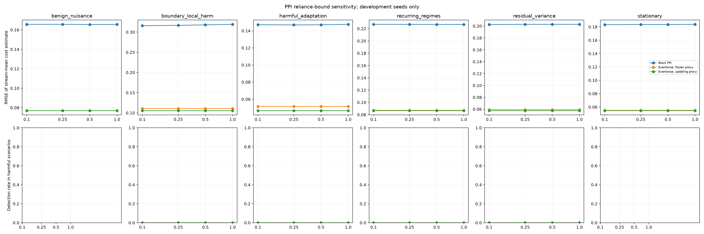

# PPI reliance-bound sensitivity

Development-only sensitivity on the same 30 seeds used for block-size development. Block size is 20 with 4 labels per block; scenarios, budget, alpha, predictor, and eventwise controls are held fixed. The reliance cap and initial reliance are both set to each listed value. These repeated seeds support debugging and comparison only; they are not an independent confirmation set.

|Cap|Scenario|Method|Streams|Harm reached|Detected|False escalations|RMSE|Mean true harm|Mean CS lower bound|Mean eta|
|---:|---|---|---:|---:|---:|---:|---:|---:|---:|---:|
|0.10|benign_nuisance|pprm_block_adaptive|30|0/0|0/0|0/30|0.1657|0.0821|0.187|0.030|
|0.10|benign_nuisance|uniform_proxy|30|0/0|0/0|0/30|0.0770|0.0819|n/a|n/a|
|0.10|benign_nuisance|uniform_proxy_frozen|30|0/0|0/0|0/30|0.0770|0.0819|n/a|n/a|
|0.10|boundary_local_harm|pprm_block_adaptive|30|30/30|0/30|0/30|0.3157|0.3777|0.329|0.039|
|0.10|boundary_local_harm|uniform_proxy|30|30/30|0/30|0/30|0.1057|0.3784|n/a|n/a|
|0.10|boundary_local_harm|uniform_proxy_frozen|30|30/30|0/30|0/30|0.1108|0.3784|n/a|n/a|
|0.10|harmful_adaptation|pprm_block_adaptive|30|30/30|0/30|0/30|0.1471|0.3696|0.334|0.039|
|0.10|harmful_adaptation|uniform_proxy|30|30/30|0/30|0/30|0.0466|0.3697|n/a|n/a|
|0.10|harmful_adaptation|uniform_proxy_frozen|30|30/30|0/30|0/30|0.0516|0.3697|n/a|n/a|
|0.10|recurring_regimes|pprm_block_adaptive|30|30/30|0/30|0/30|0.2270|0.2211|0.301|0.028|
|0.10|recurring_regimes|uniform_proxy|30|30/30|0/30|0/30|0.0866|0.2202|n/a|n/a|
|0.10|recurring_regimes|uniform_proxy_frozen|30|30/30|0/30|0/30|0.0872|0.2202|n/a|n/a|
|0.10|residual_variance|pprm_block_adaptive|30|30/30|0/30|0/30|0.2026|0.1321|0.306|0.036|
|0.10|residual_variance|uniform_proxy|30|30/30|0/30|0/30|0.0576|0.1323|n/a|n/a|
|0.10|residual_variance|uniform_proxy_frozen|30|30/30|0/30|0/30|0.0593|0.1323|n/a|n/a|
|0.10|stationary|pprm_block_adaptive|30|0/0|0/0|0/30|0.1833|0.0805|0.301|0.028|
|0.10|stationary|uniform_proxy|30|0/0|0/0|0/30|0.0546|0.0807|n/a|n/a|
|0.10|stationary|uniform_proxy_frozen|30|0/0|0/0|0/30|0.0549|0.0807|n/a|n/a|
|0.25|benign_nuisance|pprm_block_adaptive|30|0/0|0/0|0/30|0.1657|0.0821|0.109|0.060|
|0.25|benign_nuisance|uniform_proxy|30|0/0|0/0|0/30|0.0770|0.0819|n/a|n/a|
|0.25|benign_nuisance|uniform_proxy_frozen|30|0/0|0/0|0/30|0.0770|0.0819|n/a|n/a|
|0.25|boundary_local_harm|pprm_block_adaptive|30|30/30|0/30|0/30|0.3166|0.3777|0.280|0.085|
|0.25|boundary_local_harm|uniform_proxy|30|30/30|0/30|0/30|0.1057|0.3784|n/a|n/a|
|0.25|boundary_local_harm|uniform_proxy_frozen|30|30/30|0/30|0/30|0.1108|0.3784|n/a|n/a|
|0.25|harmful_adaptation|pprm_block_adaptive|30|30/30|0/30|0/30|0.1469|0.3696|0.284|0.070|
|0.25|harmful_adaptation|uniform_proxy|30|30/30|0/30|0/30|0.0466|0.3697|n/a|n/a|
|0.25|harmful_adaptation|uniform_proxy_frozen|30|30/30|0/30|0/30|0.0516|0.3697|n/a|n/a|
|0.25|recurring_regimes|pprm_block_adaptive|30|30/30|0/30|0/30|0.2269|0.2211|0.251|0.053|
|0.25|recurring_regimes|uniform_proxy|30|30/30|0/30|0/30|0.0866|0.2202|n/a|n/a|
|0.25|recurring_regimes|uniform_proxy_frozen|30|30/30|0/30|0/30|0.0872|0.2202|n/a|n/a|
|0.25|residual_variance|pprm_block_adaptive|30|30/30|0/30|0/30|0.2029|0.1321|0.256|0.073|
|0.25|residual_variance|uniform_proxy|30|30/30|0/30|0/30|0.0576|0.1323|n/a|n/a|
|0.25|residual_variance|uniform_proxy_frozen|30|30/30|0/30|0/30|0.0593|0.1323|n/a|n/a|
|0.25|stationary|pprm_block_adaptive|30|0/0|0/0|0/30|0.1835|0.0805|0.251|0.053|
|0.25|stationary|uniform_proxy|30|0/0|0/0|0/30|0.0546|0.0807|n/a|n/a|
|0.25|stationary|uniform_proxy_frozen|30|0/0|0/0|0/30|0.0549|0.0807|n/a|n/a|
|0.50|benign_nuisance|pprm_block_adaptive|30|0/0|0/0|0/30|0.1655|0.0821|0.001|0.091|
|0.50|benign_nuisance|uniform_proxy|30|0/0|0/0|0/30|0.0770|0.0819|n/a|n/a|
|0.50|benign_nuisance|uniform_proxy_frozen|30|0/0|0/0|0/30|0.0770|0.0819|n/a|n/a|
|0.50|boundary_local_harm|pprm_block_adaptive|30|30/30|0/30|0/30|0.3179|0.3777|0.197|0.144|
|0.50|boundary_local_harm|uniform_proxy|30|30/30|0/30|0/30|0.1057|0.3784|n/a|n/a|
|0.50|boundary_local_harm|uniform_proxy_frozen|30|30/30|0/30|0/30|0.1108|0.3784|n/a|n/a|
|0.50|harmful_adaptation|pprm_block_adaptive|30|30/30|0/30|0/30|0.1470|0.3696|0.199|0.091|
|0.50|harmful_adaptation|uniform_proxy|30|30/30|0/30|0/30|0.0466|0.3697|n/a|n/a|
|0.50|harmful_adaptation|uniform_proxy_frozen|30|30/30|0/30|0/30|0.0516|0.3697|n/a|n/a|
|0.50|recurring_regimes|pprm_block_adaptive|30|30/30|0/30|0/30|0.2268|0.2211|0.167|0.078|
|0.50|recurring_regimes|uniform_proxy|30|30/30|0/30|0/30|0.0866|0.2202|n/a|n/a|
|0.50|recurring_regimes|uniform_proxy_frozen|30|30/30|0/30|0/30|0.0872|0.2202|n/a|n/a|
|0.50|residual_variance|pprm_block_adaptive|30|30/30|0/30|0/30|0.2029|0.1321|0.172|0.114|
|0.50|residual_variance|uniform_proxy|30|30/30|0/30|0/30|0.0576|0.1323|n/a|n/a|
|0.50|residual_variance|uniform_proxy_frozen|30|30/30|0/30|0/30|0.0593|0.1323|n/a|n/a|
|0.50|stationary|pprm_block_adaptive|30|0/0|0/0|0/30|0.1835|0.0805|0.167|0.078|
|0.50|stationary|uniform_proxy|30|0/0|0/0|0/30|0.0546|0.0807|n/a|n/a|
|0.50|stationary|uniform_proxy_frozen|30|0/0|0/0|0/30|0.0549|0.0807|n/a|n/a|
|1.00|benign_nuisance|pprm_block_adaptive|30|0/0|0/0|0/30|0.1656|0.0821|0.000|0.138|
|1.00|benign_nuisance|uniform_proxy|30|0/0|0/0|0/30|0.0770|0.0819|n/a|n/a|
|1.00|benign_nuisance|uniform_proxy_frozen|30|0/0|0/0|0/30|0.0770|0.0819|n/a|n/a|
|1.00|boundary_local_harm|pprm_block_adaptive|30|30/30|0/30|0/30|0.3192|0.3777|0.032|0.216|
|1.00|boundary_local_harm|uniform_proxy|30|30/30|0/30|0/30|0.1057|0.3784|n/a|n/a|
|1.00|boundary_local_harm|uniform_proxy_frozen|30|30/30|0/30|0/30|0.1108|0.3784|n/a|n/a|
|1.00|harmful_adaptation|pprm_block_adaptive|30|30/30|0/30|0/30|0.1476|0.3696|0.030|0.112|
|1.00|harmful_adaptation|uniform_proxy|30|30/30|0/30|0/30|0.0466|0.3697|n/a|n/a|
|1.00|harmful_adaptation|uniform_proxy_frozen|30|30/30|0/30|0/30|0.0516|0.3697|n/a|n/a|
|1.00|recurring_regimes|pprm_block_adaptive|30|30/30|0/30|0/30|0.2267|0.2211|0.010|0.113|
|1.00|recurring_regimes|uniform_proxy|30|30/30|0/30|0/30|0.0866|0.2202|n/a|n/a|
|1.00|recurring_regimes|uniform_proxy_frozen|30|30/30|0/30|0/30|0.0872|0.2202|n/a|n/a|
|1.00|residual_variance|pprm_block_adaptive|30|30/30|0/30|0/30|0.2029|0.1321|0.012|0.164|
|1.00|residual_variance|uniform_proxy|30|30/30|0/30|0/30|0.0576|0.1323|n/a|n/a|
|1.00|residual_variance|uniform_proxy_frozen|30|30/30|0/30|0/30|0.0593|0.1323|n/a|n/a|
|1.00|stationary|pprm_block_adaptive|30|0/0|0/0|0/30|0.1838|0.0805|0.010|0.113|
|1.00|stationary|uniform_proxy|30|0/0|0/0|0/30|0.0546|0.0807|n/a|n/a|
|1.00|stationary|uniform_proxy_frozen|30|0/0|0/0|0/30|0.0549|0.0807|n/a|n/a|

