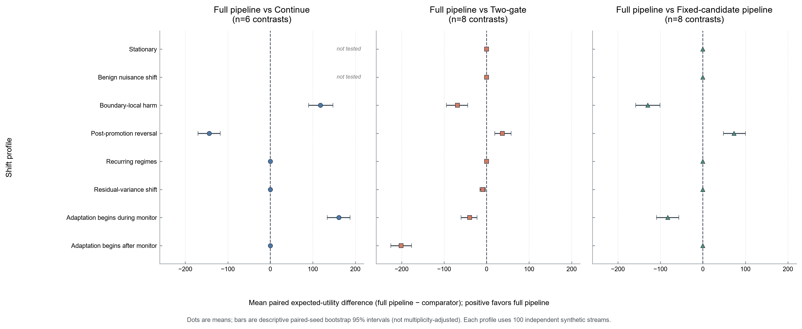

# When Should Models Adapt? Evidence on Decision-Aware Monitoring and Cost-Constrained Intervention under Distribution Shift

**Status:** research manuscript draft v0, 2026-10-26. This draft is intentionally claim-bounded. The working scope is a retrospective benchmark and failure analysis across Q1–Q3; publication-level differentiation remains unverified. The draft is not submission-ready: source-by-source literature/comparator review, final figure/table integration and internal review, coauthor review, charter-aligned real-data coverage, and artifact freeze remain open. It does not claim a novel algorithm or a fully validated unified system.

## Abstract

Distributional change, predictive degradation, and downstream decision harm are distinct phenomena, yet monitoring and adaptation systems often treat evidence of one as evidence for another. We evaluate existing and project-specific methods for detecting decision harm, selecting and certifying a replacement, and allocating labels or retraining resources. The primary real-data results report three distinct component studies—EIA forecast/refit, Upworthy package selection, and an exploratory Open Bandit candidate gate—alongside separately identified exploratory and feasibility results from other sources. In matched immediate-feedback synthetic comparisons, a direct bounded paired-cost monitor did not demonstrate an advantage over an established bounded-risk comparator after multiplicity correction. Under one registered sparse-label design, a prediction-powered paired-cost e-value improved average detection over a fixed-mixture comparator by 12.50 percentage points (95% seed-bootstrap interval 11.17–13.83), with gains concentrated at the lower query rate. In a separate IID candidate-selection design, Target-Scout exceeded fixed sample-split and pooled-rank certification in expected net gain, but this result is specific to its candidate family and resource contract. A fixed-horizon active-inference adaptation reduced estimation error relative to matched-spend uniform sampling in 30 synthetic seeds, but this is exploratory rather than coverage calibration; corrected Robust ASI had lower RMSE at 9/10 budgets on one held sample. The integrated monitor–scout–certify–intervene pipeline showed profile-specific benefits and consequential failures, including late-onset and post-promotion reversal failures; its controller ablation did not change decisions. A 2026 EIA replay found lower forecast error for adaptive refitting under assumed feedback delays, while a randomized Upworthy package-selection evaluation found a 0.1002 percentage-point CTR increase over uniform choice on its project-relative holdout. An exploratory fixed-candidate Open Bandit replay estimated a +0.001809 position-1 click-value difference, but MOPE returned an empty confidence set at event 866 and did not promote; its feedback and dependence assumptions are unresolved. These real-data studies evaluate separate components and do not validate an end-to-end system. The evidence supports endpoint separation, strong task-matched baselines, and explicit intervention costs; it does not establish a broadly superior adaptation algorithm or a real-world deployment guarantee.

## 1. Introduction

Models encounter changes in inputs, outcomes, feedback availability, and operating conditions. An observed shift can be large while decisions remain adequate; predictive error can worsen without changing the preferred action; and a decision policy can become harmful even when conventional shift statistics are quiet. Recent work addresses bounded-risk monitoring (Timans et al., 2025), weighted-conformal monitoring and adaptation (Prinster et al., 2025), predictive-risk monitoring (Zhang et al., 2026), and risk monitoring of models that continue adapting at test time, including an unlabeled loss-proxy route (Schirmer et al., 2025). Ahmed et al. (2026) provide a close temporal-shift failure-analysis precedent: on a natural cybersecurity shift pair, label-free confidence/agreement estimators can select collapsed models, while adaptation and conformal coverage also fail. Their findings make clear that a broad claim to be the first audit of monitoring/adaptation failures under temporal shift is unavailable. ShiftLab's endpoints and tasks differ, but that difference is not itself evidence of a contribution. These works target distinct criteria. A system that responds to any alarm by adapting risks paying intervention costs without improving outcomes. Conversely, a system that waits for a generic prediction metric can miss changes that matter to the downstream decision.

Decision-aligned shift analysis is already established for worst-case distribution shifts in resource-allocation problems (Ren et al., 2024), and online utility optimization with action-dependent selective labels is established under IID arrivals (Wei, 2021). A 2026 arXiv preprint also frames temporal deployment maintenance as control of AUC/ECE volatility against an intervention-cost frontier, using annual credit-risk cohorts and drift-triggered recalibration/retraining (Rahman & Tabassum, 2026). Its objective and full-label annual protocol differ from our paired-cost and logged-bandit tasks, so no numerical comparison is warranted; it nevertheless rules out generic novelty claims for cost-aware maintenance under temporal shift. Together, these works rule out novelty claims based only on downstream decision loss, cost-aware information acquisition, or intervention-cost frontiers.

We study three quantities separately. Let $P_t$ denote the distribution of available inputs at time $t$, $f$ a predictive model, $\pi$ a decision policy, and $c$ a declared decision cost. The quantities are distributional change $D(P_t,P_0)$, predictive degradation $R_t(f)-R_0(f)$, and policy-relative decision harm $R_t(\pi)-R_t(\pi_{\rm ref})$, where $R_t(\pi)=\mathbb{E}[c(\pi(X_t),Y_t)]$. They answer different questions and need different feedback and inference assumptions.

Our research questions are: (Q1) when can a monitor identify material downstream harm rather than a change in a proxy endpoint; (Q2) how should a candidate be selected and certified against a declared incumbent; and (Q3) how should scarce labels, computation, retraining, switching, and fallback actions be allocated? We treat the proposed framework as a sequence of evidence and action decisions, not as a presumption that one algorithm solves all three.

The study follows a benchmark-first strategy. We compare existing procedures before proposing new methods, preserve negative results, and regard an algorithm as justified only if a task-matched gap remains after established methods are included. The present evidence leads to a no-go decision for a new RIVE/ASC-style algorithm in this iteration. The standalone harm gate has established comparators; the integrated system has mixed synthetic behavior; and current real data do not support an end-to-end prospective intervention claim.

### Contributions and scope

This draft makes four bounded contributions:

1. It organizes shift monitoring, predictive-risk monitoring, decision-cost monitoring, candidate certification, and resource allocation by their estimands and information contracts.
2. It reports source-pinned or independently checked comparisons for direct bounded-risk monitoring, prediction-powered selective-label monitoring, candidate certification, logged-bandit policy evaluation, and retraining-resource rules.
3. It reports an independently checked integrated synthetic experiment that includes both favorable profiles and failure cases, rather than aggregating component gains into a presumed system benefit.
4. It reports three distinct real-data component evaluations—EIA forecasting/refit resources, Upworthy package selection/CTR, and an exploratory Open Bandit candidate gate—and states why none is evidence for a complete real-data monitor–certify–intervene system.

These results do **not** establish a novel sequential test, a novel evidence-to-switching framework, a universal performance advantage, prospective validity on real data, or a common numerical frontier across Q1–Q3. In particular, cost-aware retraining and sequential challenger switching already have close precedents (Regol et al., 2025; Digalakis et al., 2026 preprint), while budgeted conformal repair studies cost-ordered intervention selection for another task (Löfström, 2026). Ahmed et al. (2026) also publish a systematic temporal-shift failure audit of label-free monitoring and test-time adaptation. The present draft does not yet establish a differentiated contribution against these works.

## 2. Problem and information contract

### 2.1 Outcomes and estimands

For a policy pair $(\pi,\pi_{\rm ref})$, define the event-level gain $G_t=c(\pi_{\rm ref}(X_t),Y_t)-c(\pi(X_t),Y_t)$, so positive values favor the candidate. A material-harm monitor tests a declared null on the sign and scale of this paired quantity. The precise null may be conditional eventwise, a running-average risk constraint, or a fixed-horizon mean; these are not interchangeable. Feature-shift tests instead monitor a chosen statistic of $X_t$. Predictive-risk procedures monitor a loss such as $\ell(f(X_t),Y_t)$. We report each endpoint on its own scale.

When outcomes are selectively observed, the learner sees (X_t), its own predictions and actions, query decisions and probabilities, and labels only after they arrive. An evaluator may know full synthetic potential outcomes, but that information is excluded from learner inputs. For real randomized tasks, the evaluation unit and assignment mechanism are source-specific. We do not infer individual-level outcomes from aggregate package-level counts.

### 2.2 Time, feedback, and costs

The stream contract distinguishes event occurrence, feature availability, prediction, decision, query, label arrival, model update, promotion, rollback and fallback. A source event timestamp is not assumed to be a label-release timestamp. Sequential guarantees require a stated filtration, predictable policy and query selection, bounded score, support/positivity, and a conditional-mean or exchangeability condition appropriate to the method. A valid component guarantee does not imply validity after adaptive composition.

Labels, computation, retraining, switching, and downstream decision costs are measured separately unless a defensible conversion puts them in common units. Where no such conversion exists, we report a frontier or separate columns. In particular, EIA update counts are resource proxies rather than monetary intervention cost, and Upworthy CTR is not revenue.

## 3. Methods and benchmark design

### 3.1 Controlled synthetic streams

The synthetic suite contains stationary controls, large benign nuisance shifts, boundary-local harm, recurring regimes, residual-variance changes, and harmful adaptation, with an evaluator that retains oracle policy costs and true change parameters outside model inputs. The integrated confirmation compared nine methods across eight profiles with 100 seeds per profile, a 3,200-event stream, staged fit/monitor/scout-certification periods, and a total 640-label cap. Its protocol, data split, event logs, and source hashes are recorded in the frozen experiment manifest.

Component experiments have separate protocols. The Timans comparison used 1,000 seeds per null control and 300 per alternative. The PPE calibration covered 16 registered cells with 1,000 streams each and its fresh alternative confirmation replayed 6,400 streams. Target-Scout used 300 matched seed blocks per positive-signal cell after an exact-rule null-calibration gate. MOPE and OPI used logged-bandit synthetic streams and are reported separately from common-label settings. These sample sizes and metrics cannot be combined into a single algorithm ranking.

### 3.2 Methods compared

For direct bounded paired-cost monitoring, the frozen DIVE component is a fixed mixture of bounded betting processes. Under its conditional-mean null and a known bound, each factor has conditional expectation at most one; the class itself cannot verify that the real data or filtration satisfy the assumptions. Timans et al.'s bounded-risk monitor and the paired-score confidence-sequence method of Choe and Ramdas are established matched comparators, with their distinct nulls reported explicitly. Schirmer et al.'s TTA monitor is an additional scope comparator for online model updates, but targets running predictive risk and requires a different TTA/proxy-calibration contract; it is not scored as paired decision-harm detection here.

For sparse labels, the PPE adaptation applies a predictable proxy-plus-residual correction to a base paired-cost e-factor, adapting the general construction of Csillag et al. It requires a valid base factor, randomized predictable label acquisition, positive known propensities, and bounded nonnegative corrected factors. PPRM (Zhang et al.) is assessed on predictive risk and is not scored as a decision-cost monitor.

For candidate choice under shared labels, Target-Scout selects using an early target slice and certifies on fresh data under a shared hard budget. The fixed sample-split and pooled-rank alternatives use the same generated streams and label cap. Under logged-bandit feedback, MOPE's fixed-candidate gated deployment (Karampatziakis et al., 2021) and a fixed-horizon Hoeffding control are compared; anytime-valid optimal policy identification (Molitor, 2026) is kept separate because it addresses a finite-class identification target rather than the same gate. Wang (2026, arXiv preprint) gives an instance-optimal sequential certificate for policy improvement from known history-dependent logged episodes, with an information-theoretic lower bound and an asymptotically matching certifier under its coverage conditions. We compared a labeled one-step binary-reward specialization with pinned MOPE and fixed-horizon Hoeffding on registered IID synthetic streams; this does not establish validity for contextual OBD logs. The Q2 logged-policy frontier remains incomplete, and the current OBD result does not settle the comparison. Sequential incumbent–challenger switching with costed deployment is also studied by Digalakis et al. (2026 preprint); their setting assumes a progressively expanding feature set and challenger learning curve, so it is not a drop-in common-label comparator here. Our source-level scope and non-reproduction decision are documented in [`challenger_switching_fidelity_audit.md`](challenger_switching_fidelity_audit.md).

For retraining, the EIA frontier includes never/always/periodic and error-trigger controls, plus UPF (Regol et al., 2025), CARA (Mahadevan and Mathioudakis, 2023), RCCDA (Piaseczny et al., 2025), ADWIN and DDM adaptations. These are fitted to the EIA forecast task under assumed feedback delays. They are adaptations to an event-time regression task, not reproductions of every method's published classification experiments. Resource schedules and prediction loss are kept distinct from candidate-policy intervention utility. Rahman and Tabassum (2026) provide a close scope comparator on AUC/ECE-trajectory volatility versus intervention costs; their annual full-label credit-risk task and retrospective threshold frontier do not match EIA or our sequential harm task.

For fixed-horizon label allocation, we include an Active Statistical Inference adaptation and a corrected Robust ASI reproduction, each with uniform-sampling controls at matched expected budgets. These procedures target estimation efficiency under batch covariate access, not sequential monitoring, promotion safety, or intervention utility.

### 3.3 Real-data tasks

**EIA 2026:** models predict next-hour demand for CISO and ERCO from four contemporaneous EBA series. Training/calibration are chronologically separated from the 2026 test period. Frozen Ridge, weekly refit, monthly refit, and error-triggered refit are compared under 0-, 24-, and 168-hour assumed feedback delays. A separate CUDA replay checks reproducibility of aggregate metrics, monthly metrics, block intervals and report outputs. The release/label time is unknown; delay values are sensitivities.

**Upworthy:** a text-only package selector is trained on the exploratory partition and compared with a uniform-over-packages reference on the official holdout after a predeclared conservative date exclusion. The evaluation unit is the headline experiment, and uncertainty is clustered by week. CTR is the only observed utility. The split is public and project-relative; there is no sequential label-arrival stream, economic cost, or future-time holdout.

These task families are not pooled. The archive's publisher-described design and its later randomization correction are documented by Matias et al. (2021, 2024). Neither task supplies a complete monitor–certify–intervene evaluation.

## 4. Results

### 4.1 Shift and decision harm are distinct

Across the registered synthetic profiles, nuisance change can occur without the declared decision-cost harm, while harmful adaptation and local/recurring changes can alter policy-relative cost. Consequently, a feature-shift alarm is a diagnostic signal rather than evidence that the deployed policy's expected cost crossed a material-harm threshold. The examples establish this distinction for the simulated generators and cost design; they do not imply that shift and harm are statistically independent in general.

### 4.2 Direct paired-cost monitoring has strong established baselines

In the matched immediate-feedback Timans experiment (Timans et al., 2025), official formulas were independently replayed with maximum absolute log-wealth errors of 0 and $1.86\times10^{-7}$ for the two implementations. False escalations were 0–2 per 1,000 streams in each registered null cell; each method detected 300/300 boundary-local, recurring-regime and harmful-adaptation streams, while residual-variance detection was 8–11/300. No Holm-adjusted paired difference was significant. In a **separate** Comparecast confirmation (Choe and Ramdas, 2023), it detected 295/300 boundary-local, 212/300 recurring, and 300/300 harmful-adaptation streams, while DIVE detected 300/300 in each; these counts are descriptive only because the running-average null used by Comparecast differs from DIVE’s conditional-mean null. These findings do not support novelty for a standalone bounded paired-cost monitor, and they do not establish equivalence or universal inferiority.

### 4.3 Selective labels and candidate certification show conditional gains

PPE (Csillag et al., 2025) passed its registered simulation calibration: zero false alarms were observed in each of 16 cells of 1,000 streams, with a maximum adjusted one-sided exact upper bound of 0.5752%. In the fresh alternative grid it detected 67.71% versus 55.21% for the fixed-mixture comparator, a paired difference of 12.50 percentage points (95% stream-seed bootstrap interval 11.17–13.83). The gain was concentrated at query rate 0.20; at query rate 0.40 PPE did not improve the fixed-mixture rate. Thus the evidence is specific to the registered sparse-label design and does not establish broader superiority.

Target-Scout exceeded fixed sample split by 8.7607 expected-net-gain units (97.5% interval 7.2301–10.3668) and pooled rank by 6.6660 (5.2745–8.0539) across the registered positive-signal cells. The lower limits exceeded the predeclared +1 practical margin. All methods respected the shared label budget and had zero harmful promotions under the registered confirmation. This is a synthetic result for a particular IID candidate family and cost structure. It is neither a real-data result nor a novelty claim about candidate certification.

In one registered IID logged-bandit experiment, MOPE promoted 991/1,000 positive-gain candidates versus 717/1,000 for the fixed-horizon Hoeffding comparator in the +0.12 cell, with a paired power difference of +27.4 percentage points (95% interval +24.7 to +30.2) and 94.315 fewer labels on average. MOPE had 6/1,000 promotions under the zero-mean null and 1/1,000 under the negative-gain null; the simultaneous one-sided upper bound across seven error endpoints was 1.5036%. Empty confidence paths were retained and reported. A separate matched MOPE/OPI comparison used a +0.15 candidate and a 200-event horizon: MOPE promoted 279/300 versus 92/300 for fixed-horizon Hoeffding, while OPI did not identify a singleton by the horizon; its all-tied null had 11/1,000 MOPE promotions and three empty paths. The studies answer different registered designs. Together they illustrate that candidate gates already exist for supported IID logged-bandit feedback, not that the methods are valid on OBD or superior on shared-label Target-Scout’s estimand.

A further frozen comparison implemented only the Certification Exponent's one-step binary-reward specialization. Under an equal-value null it certified 16/1,000 streams, compared with 11/1,000 for pinned MOPE; under the alternative the rates were 270/300 and 279/300. The paired rate difference was −3 percentage points (exact two-sided McNemar *p*=0.0636), so this experiment does not establish a detection-rate difference. Kelly used fewer labels on average in this design (96.18 versus 114.04). Its fixed-horizon Hoeffding arm certified 92/300 alternatives, with no certifications in 1,000 null streams. An independent reconstruction reproduced the generated streams and all MOPE paths. This remains a context-free IID synthetic comparison; it is neither a complete reproduction of the Certification Exponent paper nor evidence of OBD validity. Full protocol and results: [`Certification Exponent one-step comparison`](certification_exponent_one_step_results.md).

### 4.4 The integrated pipeline has failure modes and no general advantage

The frozen 100-seed-per-profile integrated confirmation found that the full pipeline improved over continuing on two monitor-aligned harm profiles, with paired expected-utility contrasts of +118.01 and +161.16 units. Simpler two-gate and fixed-candidate arms performed better in those same profiles. The pipeline did not show benefit for recurring regimes, residual-variance change or native late onset; under the registered post-promotion reversal it incurred expected utility contrast −143.76. The controller and non-controller arms made the same decisions. These results make the current system unsuitable for an unqualified general-superiority claim. Utility units are synthetic and do not transfer to real costs.

Figure 1 visualizes all 22 registered full-pipeline contrasts. The three panels retain the comparator-specific contrast sets; the two stationary/nuisance comparisons against Continue were not part of that set and are marked “not tested.” Error bars are descriptive paired-seed bootstrap intervals, not multiplicity-adjusted intervals or the registered Holm tests. The figure uses the official [PaperBanana/PaperVizAgent plot-style guide](https://github.com/google-research/papervizagent/blob/e088a8fff74cc363b6897c0843631fff76484908/style_guides/neurips2025_plot_style_guide.md); it is rendered deterministically from the source table, not generated by the API-driven agent pipeline.

**Figure 1:** Integrated synthetic efficacy confirmation (100 independent streams per profile). Points show mean paired expected-utility differences of the full pipeline relative to the named baseline; positive values favor the full pipeline. Bars show descriptive paired-seed bootstrap 95% intervals, not multiplicity-adjusted. The registered 22 one-sided contrasts use Holm adjustment; consult the result table for adjusted tests and simultaneous lower bounds. Synthetic results under the frozen 640-label cap; not real-data confirmation.

### 4.5 Label acquisition is a fixed-horizon estimation problem here

In the 30-seed synthetic paired-cost development comparison, the ASI adaptation used 526.15 expected labels (526.93 realized) and had MAE 0.0087, RMSE 0.0111, mean 95% asymptotic interval width 0.0488, and 30/30 observed coverage. The matched-spend uniform arm had MAE 0.0176, RMSE 0.0203, width 0.0801, and 30/30 coverage. The paired bootstrap favored ASI on error and interval width in this sample, but 30 seeds do not calibrate its asymptotic coverage, and the target-batch synthetic design is immediate feedback with a known parametric law.

In a separate corrected reproduction of Robust ASI (Li et al., 2025), repeated Bernoulli queries were run on one seeded 20,000-record California ACS sample, with 500 query trials per method and budget. Robust active sampling had lower RMSE than uniform at 9/10 budgets; active sampling alone did so at 4/10. Cross-validation chose the maximum tested radius at 9/10 budgets. This is a reproduction on one fixed sample with repeated query randomization, not ten independent datasets, and it does not validate a sequential or policy-intervention claim.

### 4.6 Real-data component outcomes do not join into a system result

On the Open Bandit Dataset (Saito et al., 2021), Random/all, a candidate item chosen from three training days
had a positive held-forward IPW click-value contrast of +0.001809 over the
uniform logger across 274,737 position-1 impressions. The fixed-candidate MOPE
gate did not promote: its confidence set became empty at event 866, and the
matched fixed-horizon Hoeffding lower bound was also negative. The first 1,000
events matched the pinned CVXPY reference path exactly, and the full aggregate
replay was independently reconstructed. This is one exploratory seven-day
sequence with prior ShiftLab OPE exposure, no verified click-release times,
and unresolved user/slate dependence; it establishes neither candidate harm
nor MOPE validity on OBD. See the task contract and optimizer verification in
the reproducibility index.

On the U.S. Energy Information Administration's EBA dataset, using the 2026 event period (U.S. EIA, EBA bulk file), every adaptive refit rule reduced forecast error relative to frozen Ridge in both authorities and under the three assumed delays. CISO frozen RMSE was 2,235.80; weekly refit ranged 1,651.21–1,672.10 and monthly 1,686.21–1,705.05. ERCO frozen RMSE was 2,013.63; weekly refit ranged 2,004.16–2,005.08 and monthly 2,005.55–2,006.63. Weekly refitting used 41 updates per authority; monthly used 9. These are retrospective prediction/resource findings; the source has no verified label-release times and update counts are not monetized.

On the Upworthy Research Archive (Matias et al., 2021), the selector's equal-test CTR exceeded uniform package choice by 0.001002 (0.1002 percentage points) on 3,808 eligible holdout tests; the 95% week-cluster interval was 0.000850–0.001170, and the impression-weighted difference was 0.000981. This supports the fixed-horizon task result under the declared exclusion and transfer assumptions only. It does not estimate revenue, prospective platform utility, or online monitoring performance.

Other real-data runs in the repository are retained as exploratory evidence and are not independent confirmation. They are summarized here so the three primary studies above are not mistaken for the complete acquisition/evaluation record.

| Source and procedure | Observed result | Evidence boundary |
|---|---|---|
| CRSP CIZ retrospective paired-cost monitor (CRSP, 2025) | The frozen Ridge policy's paired cost was lower than the same-date market-direction reference by 0.0003357 per event (two-way PERMNO × 20-date-block bootstrap 95% interval for candidate-minus-reference: [−0.0006550, −0.0000415]). Paired-cost CUSUM and the bounded excess-cost e-process did not cross; predictive-loss CUSUM and sampled feature MMD did cross. | One previously examined 2020–2025 path; historical feature release and execution costs are unknown or imposed. This is not sequential-validity evidence or trading-profit evidence. See [`CRSP monitor report`](../../docs/crsp_monitor_comparison_results.md). |
| CRSP CIZ train-selected policy pilot (CRSP, 2025) | A 100-PERMNO training-selected CUDA Ridge policy had worse test RMSE than a training-mean predictor but lower imposed capped decision cost than the same-date market-direction reference by 0.0005581 per event at 5 bps (20-date block descriptive interval [−0.0009119, −0.0002021]). | Only 30 sampled PERMNOs appeared in the test period; the test was previously examined, release times are unknown, and cost/capping assumptions are imposed. This is a sampled descriptive result, not independent confirmation or an economic trading result. See [`CRSP pilot results`](crsp_decision_policy_pilot_results.md). |
| UCI Gas Sensor batch-held-out candidate selection (Vergara, 2012) | Under the imposed 5× class-6 error cost, validation selected a retrained model that later had higher test cost than the incumbent: incumbent-minus-candidate gain −0.02419 (row-weighted) over batches 7–10. Under symmetric and 2× costs, validation retained the incumbent. | Four test batches were already examined in earlier diagnostics; within-batch order is unavailable and the costs are imposed. See [`Gas Sensor results`](real_data_development_results.md). |
| WILDS CivilComments sample-split candidate selection (Koh et al., 2021) | The validation-selected model reduced imposed test cost relative to the incumbent by +0.01250, +0.05038, and +0.00467 across three cost settings, with article-cluster intervals above zero. | The official test set has earlier diagnostic exposure. The split is offline, and costs are imposed; this is not independent confirmation or sequential certification. See [`WILDS selection results`](real_data_development_results.md). |
| WILDS CivilComments PACE gate (Koh et al., 2021) | The paired PACE gate retained the incumbent, while a fixed-sample McNemar gate promoted. The resulting fixed-sample choice had 0.00836 higher test accuracy than the PACE choice. | The official test had prior diagnostic exposure; article exchangeability and offline ordering are assumptions. Not a real-time utility or run-level familywise guarantee. See [`WILDS PACE results`](real_data_development_results.md). |
| CriteoPrivateAds click prediction with assumed feedback delays (Sebbar et al., 2025) | In one CUDA seed, weighted log loss and imposed target-weighted classification costs improved after updates; unweighted Brier score worsened slightly. | Feedback maturity, target prevalence and costs are assumptions. Five adjacent evaluation days and one model seed do not supply reliable cluster uncertainty or campaign value. See [`CriteoPrivateAds results`](criteo_privateads_cost_development_v1.md). |
| Criteo Attribution delayed conversion (Diemert et al., 2017) | The aggregate-only maturity audit found 3.31% of labels mature by the last impression under the declared 30-day convention. | This does not support an informative within-stream monitor comparison under that convention; it is a source-feasibility finding, not a model result. See [`maturity inventory`](real_data_inventory.md) and [`audit protocol`](criteo_maturity_audit_protocol.md). |
| Hillstrom randomized email allocation (MineThatData, 2008) | At the imposed $0.25/email cost, the neural T-learner versus random-capacity net-value estimate was −$0.02578/customer (row-level Wald 95% interval [−$0.16538, $0.11381]); Ridge and historical targeting intervals also included zero. | Exposed test split, one source, no event/label-release times, imposed costs, and row-independent Wald intervals. It does not show a reliable learned-policy gain or actual campaign profit. See [`Hillstrom results`](real_data_development_results.md). |

These additional results broaden the failure and feasibility record but do not close the real-data gate: the tasks use different units and information contracts, several evaluation partitions were exposed, and none evaluates the complete monitor–certify–intervene system under a verified prospective feedback process.

## 5. Discussion

The central empirical lesson is not that every model should adapt, but that the evidence used to trigger action must match the decision and feedback contract. Feature shift, predictive risk, paired policy cost, logged-policy value, and retraining cost are related but distinct targets. Statistical validity belongs to a stated score, filtration, acquisition process and null; it does not automatically compose across adaptive stages. A positive certification on a shadow slice is not a promise of future net benefit under unrestricted shift.

The benchmark also reveals where existing methods already solve parts of the proposed agenda. Timans-style bounded-risk monitoring and paired-score confidence sequences (Choe and Ramdas) provide strong direct-monitor comparators; WATCH (Prinster et al.) addresses weighted-conformal monitoring, and Schirmer et al. extend sequential predictive-risk monitoring to models adapting at test time, including an unlabeled proxy bound under their calibration condition. PPE provides a principled way to use proxies with selectively observed labels under strict conditions, and PPRM addresses predictive-risk monitoring. MOPE addresses a candidate-versus-logger deployment gate for supported logged bandits. Ren et al. (2024) show how downstream resource-allocation objectives change which shifts are harmful; Wei (2021) optimizes utility when actions determine which labels become observable. Target-Scout's observed gains are specific to its studied candidate family, while retraining approaches such as UPF, CARA, RCCDA and detector-triggered methods already offer resource-aware policies for their own objectives. Active Statistical Inference (Zrnic and Candes) addresses fixed-horizon label allocation and inference. A differentiated contribution cannot be claimed merely by concatenating these components.

Real-data evidence remains modular. Across the full project record, CRSP exercises monitor logic on a retrospective market path; Gas Sensor and WILDS examine offline candidate selection/gating; EIA assesses forecasting and update burden; CriteoPrivateAds tests prediction under assumed feedback delays; Hillstrom evaluates a fixed-horizon randomized email-allocation task; Upworthy assesses headline-package choice and CTR; and Open Bandit provides an exploratory logged-policy gate. Criteo Attribution is retained as a negative maturity-feasibility result. Their outcomes, units, feedback clocks, and actions differ, and several test partitions or historical windows were previously exposed. They cannot be represented as independent replications of one intervention policy. No available evidence here tests the complete sequential monitor–certify–intervene pipeline prospectively on a real task.

The research decision is therefore **no-go for a new algorithm in this iteration**. The selected working paper scope is a careful benchmark and failure analysis, but it is not yet clear that this is sufficiently differentiated from existing cost-aware retraining, challenger-switching, and temporal-shift failure-audit work. Ahmed et al. (2026) is a close precedent for monitoring/adaptation failure analysis on natural shift. The source-by-source related-work review remains open. Any unified real-world intervention claim would require a source with verified feature/decision/label timing, a defensible downstream utility, and an appropriate reference/candidate design; that claim is not currently supported.

## 6. Limitations

1. Most sequential guarantees are evaluated on synthetic streams; Monte Carlo calibration is evidence about those generators, not a proof that the real data satisfy the required conditional nulls.
2. The synthetic evaluator observes potential policy outcomes unavailable to the learner. This enables paired evaluation but does not cover performative actions where decisions change outcomes.
3. The DGPs, policies, cost ratios, monitoring windows, label budgets and delay assumptions are chosen and finite. Results may change outside those settings.
4. Several established methods have not been reproduced in their complete published task: WATCH, test-time adaptation risk monitors, some policy selection/control methods, and some resource-allocation methods remain conditional on data contracts or task assumptions.
5. The real-data sources do not provide a single common information contract. CRSP and Open Bandit are retrospective, previously examined paths with unresolved feature/label availability; EIA release times and label delays are unknown; Upworthy has aggregate experiment outcomes and no online feedback process. The additional CriteoPrivateAds, Criteo Attribution, Gas Sensor, WILDS, and Hillstrom studies have the task-specific timing, exposure, or cost limits stated in section 4.6. None is a secret prospective deployment.
6. Imposed costs and separate resource units preclude a common economic objective across tasks. We do not report a pooled net-value score.
7. Novelty is unverified. The source and task-specific audits reduce the plausible claim to empirically mapping when established components do and do not address a shared decision-harm objective; even this contribution needs a complete current literature comparison and independent review.

## 7. Conclusion

The evidence supports treating distributional change, predictive degradation, and decision harm as separate targets, and evaluating adaptation only against explicit task-matched baselines. Several methods show conditional synthetic gains, while direct monitoring overlaps with established procedures and the integrated system has important failure modes. Ahmed et al. (2026) additionally establish a close published precedent for temporal-shift monitoring/adaptation failure analysis. Real-data component results are reproducible within their protocols but do not validate the complete framework. The project should not claim a new algorithm or deployment-ready system on this evidence. The selected next step is to complete the source-by-source comparator and literature review, reconcile all manuscript claims against verified artifacts, and finish figure, table, and limitations review. If that review does not establish a differentiated empirical contribution, the decision is to stop or pivot rather than submit unsupported novelty claims.

## Reproducibility and evidence index

Protocols, source hashes, manifests and verification artifacts are listed in [`claim_evidence_map_v1.md`](claim_evidence_map_v1.md), [`evidence_inventory.md`](evidence_inventory.md), [`sota_fidelity_matrix.md`](sota_fidelity_matrix.md), [`comparator_scope_decision_v1.md`](comparator_scope_decision_v1.md), and [`programme_completion_audit.md`](programme_completion_audit.md). Exact runnable commands and environment details should be assembled from the linked protocols before external release. Current test evidence is documented in the programme audit; experiment-specific verifiers must be run for each output bundle rather than inferred from the repository-wide test suite.

## References

Core method metadata below was checked against the listed publisher or author primary source on 2026-10-26; Rahman and Tabassum (2026) was audited from the arXiv full text on 2026-10-26. The complete manuscript still needs a systematic search for additional competing work and a final citation-style pass; this list does not certify novelty.

- Center for Research in Security Prices. (2025). *CRSP U.S. Stock Databases: CIZ Flat File Format*. [Product and methodology guide](https://www.crsp.org/research/crsp-us-stock-databases-2025-layout/).
- Criteo AI Lab. (2017). *Criteo Attribution Modeling for Bidding Dataset*. [Dataset release](https://ailab.criteo.com/criteo-attribution-modeling-bidding-dataset/).
- Diemert, E., Meynet, J., Galland, P., and Lefortier, D. (2017). “Attribution Modeling Increases Efficiency of Bidding in Display Advertising.” [arXiv:1707.06409](https://arxiv.org/abs/1707.06409).
- Hillstrom, K. (2008). *MineThatData E-Mail Analytics and Data Mining Challenge*. [Dataset announcement](https://blog.minethatdata.com/2008/05/best-answer-e-mail-analytics-challenge.html).
- Koh, P. W., Sagawa, S., Marklund, H., Xie, S. M., Zhang, M., Balsubramani, A., et al. (2021). “WILDS: A Benchmark of in-the-Wild Distribution Shifts.” *Proceedings of the 38th International Conference on Machine Learning*, PMLR 139, 5637–5664. [Publisher record](https://proceedings.mlr.press/v139/koh21a.html).
- Saito, Y., Aihara, S., Matsutani, M., and Narita, Y. (2021). “Open Bandit Dataset and Pipeline: Towards Realistic and Reproducible Off-Policy Evaluation.” *NeurIPS 2021 Track on Datasets and Benchmarks*. [Proceedings paper](https://datasets-benchmarks-proceedings.neurips.cc/paper/2021/file/33e75ff09dd601bbe69f351039152189-Paper-round2.pdf).
- Sebbar, M., Odic, C., Léchine, M., Bissuel, A., Chrysanthos, N., D'Amato, A., et al. (2025). “CriteoPrivateAd: A Real-World Bidding Dataset to Design Private Advertising Systems.” [arXiv:2502.12103](https://arxiv.org/abs/2502.12103).
- Vergara, A. (2012). *Gas Sensor Array Drift at Different Concentrations*. UCI Machine Learning Repository. [Dataset DOI: 10.24432/C5MK6M](https://doi.org/10.24432/C5MK6M).
- Choe, Y. J., and Ramdas, A. (2023). “Comparing Sequential Forecasters.” *Operations Research*. Published online 17 October 2023. [DOI: 10.1287/opre.2021.0792](https://pubsonline.informs.org/doi/10.1287/opre.2021.0792); [author source and latest arXiv version](https://arxiv.org/abs/2110.00115).
- Digalakis, V., Pérignon, C., Saurin, S., and Sentenac, F. (2026). “The Challenger: When Do New Data Sources Justify Switching Machine Learning Models?” arXiv:2512.18390v2 (revised 16 July 2026; preprint). [Author preprint](https://arxiv.org/abs/2512.18390).
- Csillag, D., Struchiner, C. J., and Goedert, G. T. (2025). “Prediction-Powered E-Values.” *Proceedings of the 42nd International Conference on Machine Learning*, PMLR 267, 11493–11514. [Publisher record](https://proceedings.mlr.press/v267/csillag25a.html).
- Karampatziakis, N., Mineiro, P., and Ramdas, A. (2021). “Off-Policy Confidence Sequences.” *Proceedings of the 38th International Conference on Machine Learning*, PMLR 139, 5301–5310. [Publisher record](https://proceedings.mlr.press/v139/karampatziakis21a.html).
- Mahadevan, A., and Mathioudakis, M. (2023). “Cost-Effective Retraining of Machine Learning Models.” arXiv:2310.04216. [Author preprint](https://arxiv.org/abs/2310.04216).
- Matias, J. N., Munger, K., Le Quere, M. A., and Ebersole, C. (2021). “The Upworthy Research Archive, a time series of 32,487 experiments in U.S. media.” *Scientific Data* 8, 195. [Publisher article](https://www.nature.com/articles/s41597-021-00934-7). See also the publisher's 2024 [author correction](https://www.nature.com/articles/s41597-024-03600-w).
- Molitor, D. (2026). “Anytime-valid Optimal Policy Identification.” arXiv:2606.17515v1. [Author preprint](https://arxiv.org/abs/2606.17515).
- Wang, R. (2026). “The Certification Exponent: Instance-Optimal Sequential Certification of Policy Improvement from History Dependent Logs.” arXiv:2610.24345v1 (submitted 17 October 2026; preprint submitted to JMLR). [Author preprint and supplementary materials](https://arxiv.org/abs/2610.24345).
- Piaseczny, A., Shisher, M. K. C., Wang, S., and Brinton, C. (2025). “RCCDA: Adaptive Model Updates in the Presence of Concept Drift under a Constrained Resource Budget.” *Advances in Neural Information Processing Systems 38, Main Conference*. [Publisher proceedings record](https://proceedings.neurips.cc/paper_files/paper/2025/hash/e3d1b6d954a204267fd334cbaf9cd4af-Abstract-Conference.html).
- Prinster, D., Han, X., Liu, A., and Saria, S. (2025). “WATCH: Adaptive Monitoring for AI Deployments via Weighted-Conformal Martingales.” *Proceedings of the 42nd International Conference on Machine Learning*, PMLR 267, 49830–49859. [Publisher record](https://proceedings.mlr.press/v267/prinster25a.html).
- Schirmer, M., Jazbec, M., Naesseth, C. A., and Nalisnick, E. (2025). “Monitoring Risks in Test-Time Adaptation.” *Advances in Neural Information Processing Systems 38, Main Conference*. [Proceedings paper](https://proceedings.neurips.cc/paper_files/paper/2025/file/746960ad49ddb47248970a0e1404230c-Paper-Conference.pdf). Author code was inspected at commit `f200f00d4ca79567df0214bdd46150bb729c2227`; see [`source/task audit`](tta_monitor_fidelity_audit.md).
- Ahmed, W., Rahaman, M. A., Roy, P., and Alam, P. (2026). “The dashboard says ‘perfect:’ A systematic audit of label-free model monitoring and test-time adaptation under temporal distribution shift in network intrusion detection.” *Frontiers in Artificial Intelligence* 9, 1928858. [Publisher article](https://doi.org/10.3389/frai.2026.1928858). See [`prior-work audit`](label_free_temporal_audit_prior_work.md).
- Li, P., Zrnic, T., and Candes, E. J. (2025). “Robust Sampling for Active Statistical Inference.” *Advances in Neural Information Processing Systems 39th Conference*. [Proceedings paper](https://papers.nips.cc/paper_files/paper/2025/file/6389470564214983604d1ac81631c2c5-Paper-Conference.pdf).
- Löfström, H. (2026). “Conformal Repair on a Budget: An Empirical Protocol for Retraining Decisions.” *Proceedings of the Fifteenth Symposium on Conformal and Probabilistic Prediction with Applications*, PMLR 329, 576–591. [Publisher record](https://proceedings.mlr.press/v329/lofstrom26b.html).
- Regol, F., Schwinn, L., Sprague, K., Coates, M., and Markovich, T. (2025). “When to retrain a machine learning model.” *Proceedings of the 42nd International Conference on Machine Learning*, PMLR 267, 51369–51404. [Publisher record](https://proceedings.mlr.press/v267/regol25a.html).
- Rahman, N., and Tabassum, N. (2026). “Modeling and Controlling Deployment Reliability under Temporal Distribution Shift.” arXiv:2604.02351v1 (preprint). [Author preprint](https://arxiv.org/abs/2604.02351).
- Ren, K., Byun, Y., and Wilder, B. (2024). “Decision-Focused Evaluation of Worst-Case Distribution Shift.” *Proceedings of the Fortieth Conference on Uncertainty in Artificial Intelligence*, PMLR 244, 3076–3093. [Publisher record](https://proceedings.mlr.press/v244/ren24a.html).
- Timans, A., Verma, R., Nalisnick, E., and Naesseth, C. A. (2025). “On Continuous Monitoring of Risk Violations under Unknown Shift.” *Proceedings of the Forty-first Conference on Uncertainty in Artificial Intelligence*, PMLR 286, 4204–4226. [Publisher record](https://proceedings.mlr.press/v286/timans25a.html).
- Wei, D. (2021). “Decision-Making Under Selective Labels: Optimal Finite-Domain Policies and Beyond.” *Proceedings of the 38th International Conference on Machine Learning*, PMLR 139, 11035–11046. [Publisher record](https://proceedings.mlr.press/v139/wei21a.html).
- Wang, J. (2026). “The Certification Exponent: Instance-Optimal Sequential Certification of Policy Improvement from History-Dependent Logs.” arXiv:2610.24345v1 (preprint). [Author preprint](https://arxiv.org/abs/2610.24345).
- U.S. Energy Information Administration. Electricity Balancing Authority (EBA) bulk dataset, [bulk archive](https://www.eia.gov/opendata/bulk/EBA.zip). Retrieved 2026-10-20; frozen source checksum and temporal protocol are recorded in the EIA manifest and protocol.
- Zrnic, T., and Candes, E. (2024). “Active Statistical Inference.” *Proceedings of the 41st International Conference on Machine Learning*, PMLR 235, 62993–63010. [Publisher record](https://proceedings.mlr.press/v235/zrnic24a.html).
- Zhang, G., Cai, Y., Yu, G., and Simeone, O. (2026). “Prediction-Powered Risk Monitoring of Deployed Models for Detecting Harmful Distribution Shifts.” *Proceedings of the 43rd International Conference on Machine Learning*, PMLR 306, 154241–154262. [Publisher record](https://proceedings.mlr.press/v306/zhang26g.html).
